# NBA Performance Explorer 3.3

A basketball research site with an Arena & Film Room interface: explore NBA players,
compare careers, follow historical seasons and study the records behind each chart.
Every module identifies its source, cohort and coverage limits.

[Live website](https://nba-performance-explorer.onrender.com) ·
[3.3 release notes](docs/release/RELEASE_NOTES_3.3.md) ·
[Data and publication rights](docs/release/RIGHTS_REVIEW_3.3.md)

> **Release record:** [PR #29](https://github.com/lorenzodarioben-lgtm/nba-performance-explorer/pull/29)
> tracks 3.3 validation, final owner approval and deployment verification. At the Render
> dashboard check on 17 October 2026, the public service served `cd557e4` and 3.3 had not
> been deployed. Render watches `main` with **On Commit** deployment; merging requires
> explicit owner approval. Outstanding rights limitations are documented, and the owner
> accepts those risks for this personal, non-commercial portfolio without claiming licences.

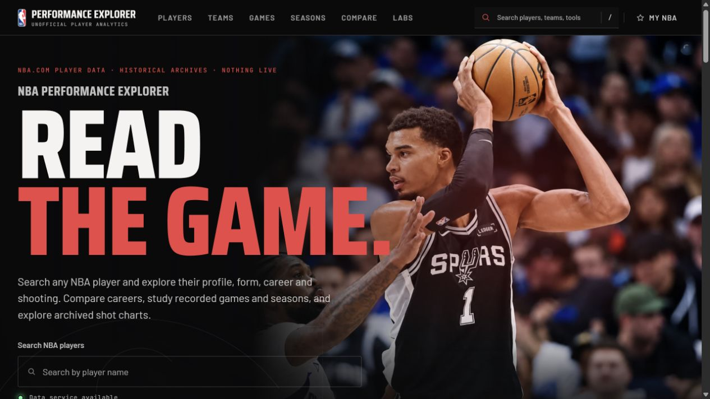

The approved 3.3 homepage, captured from the actual local production build with fixtures disabled.

<details>
<summary>Explore the final desktop application</summary>

<table role="presentation">
  <tr>
    <td width="50%">
      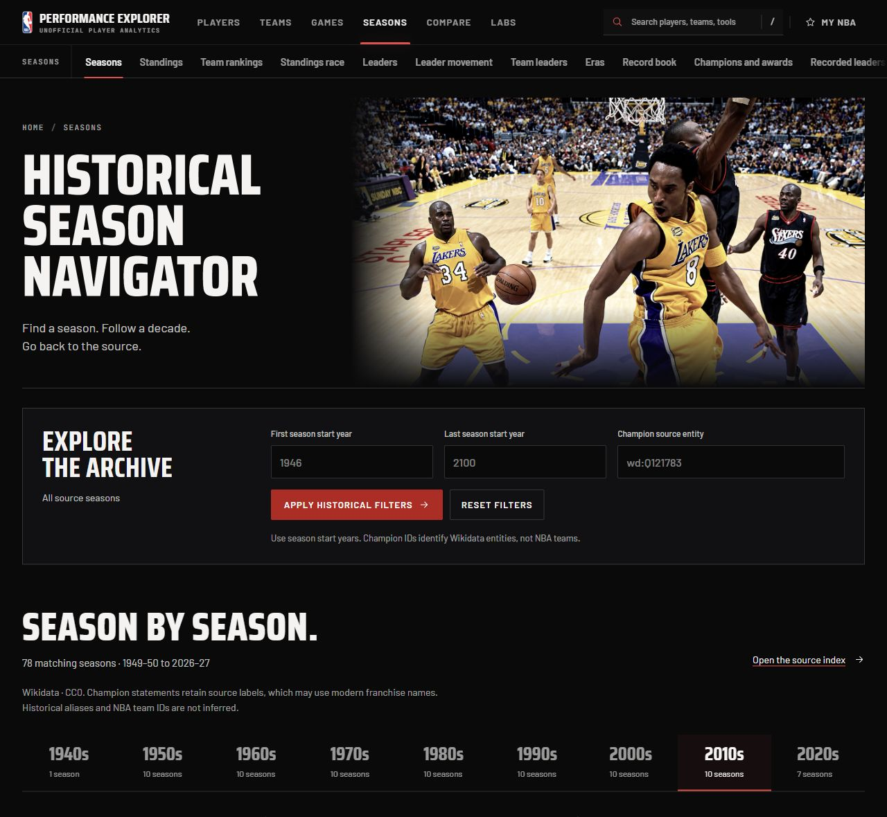
      <br /><sub>Historical Season Navigator · Wikidata CC0</sub>
    </td>
    <td width="50%">
      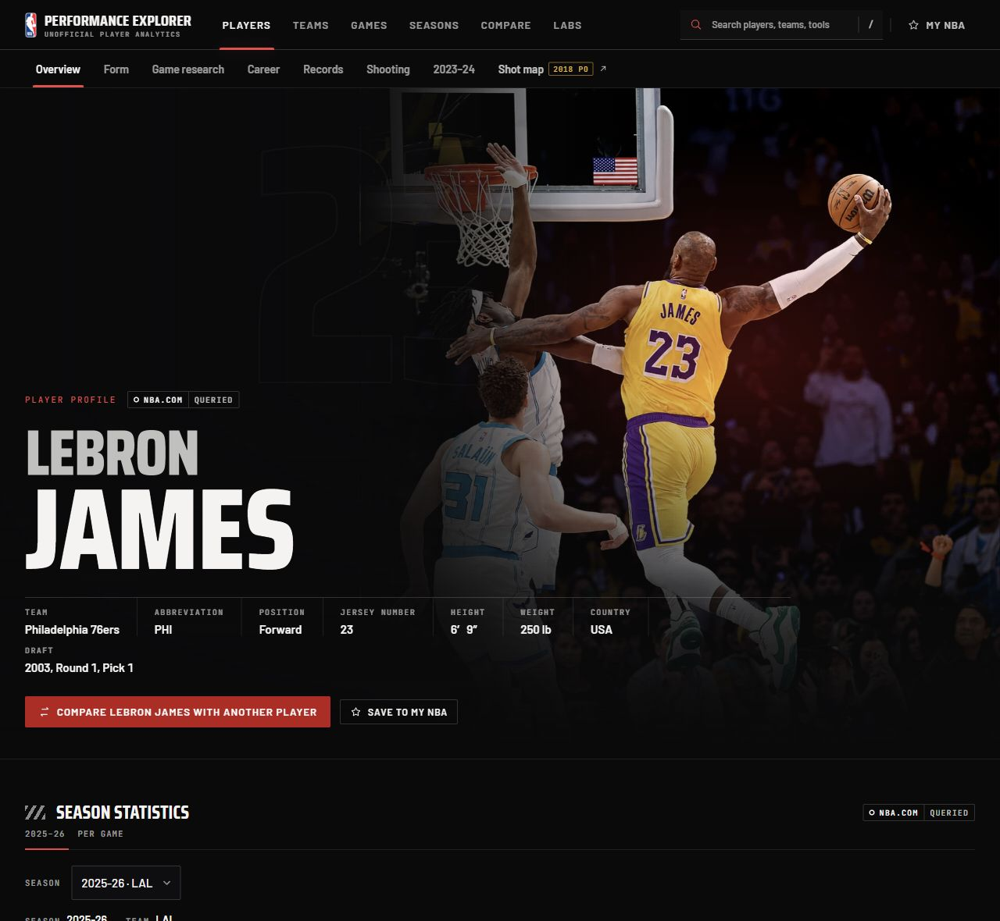
      <br /><sub>Player profile · NBA.com queried on request</sub>
    </td>
  </tr>
  <tr>
    <td width="50%">
      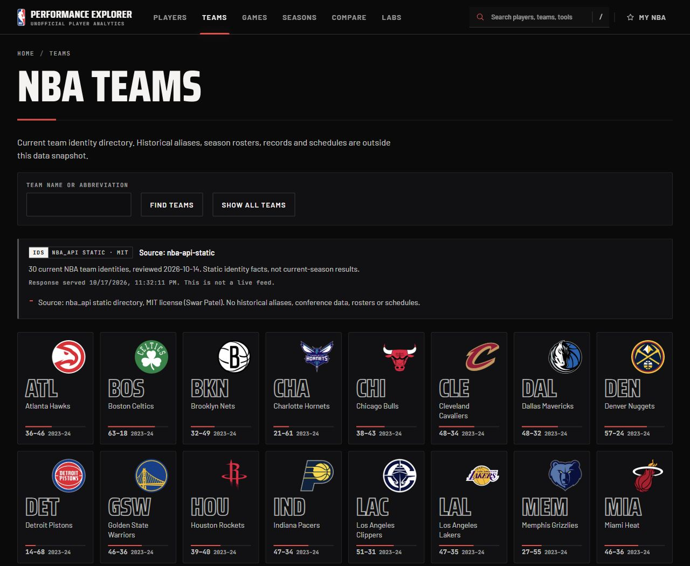
      <br /><sub>Team directory · static identities and recorded results</sub>
    </td>
    <td width="50%">
      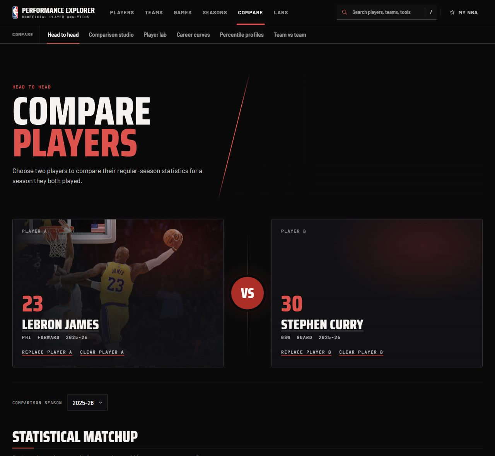
      <br /><sub>Player comparison · genuine queried season and career data</sub>
    </td>
  </tr>
  <tr>
    <td width="50%">
      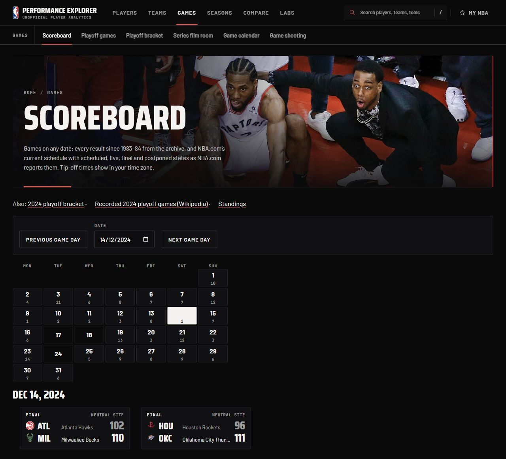
      <br /><sub>Scoreboard · archived NBA.com finals, December 14, 2024</sub>
    </td>
    <td width="50%">
      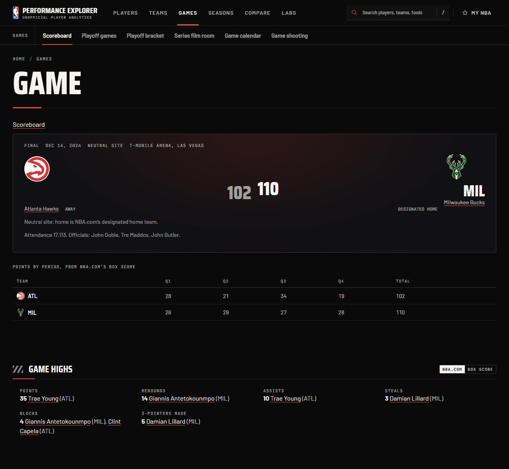
      <br /><sub>Game experience · archived final and NBA.com box score</sub>
    </td>
  </tr>
  <tr>
    <td width="50%">
      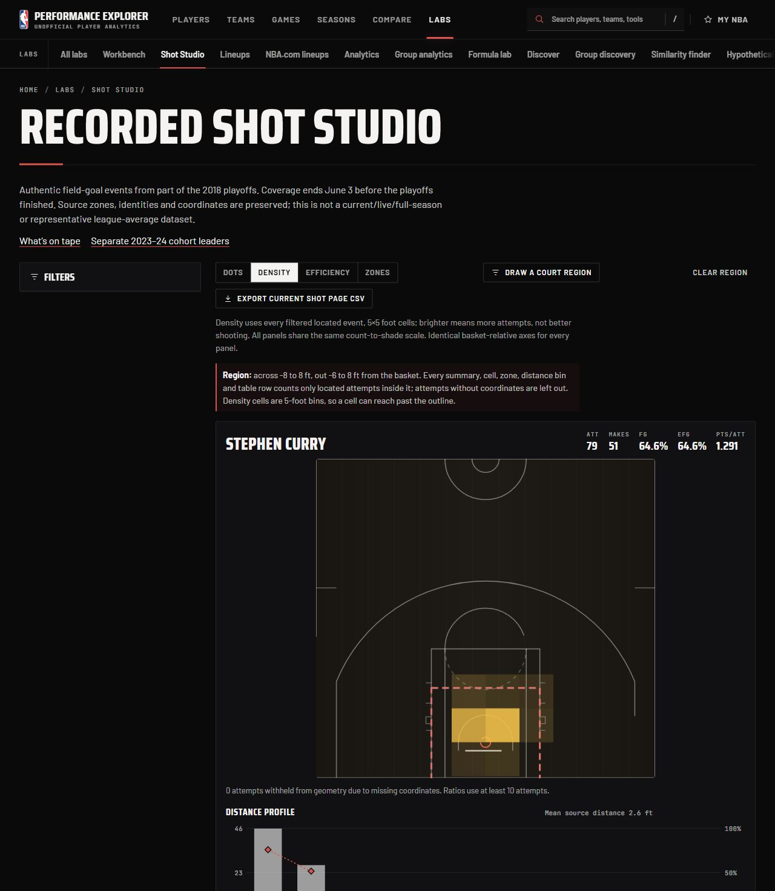
      <br /><sub>Shot Studio · partial 2018 playoff archive, Kaggle CC0</sub>
    </td>
    <td width="50%">
      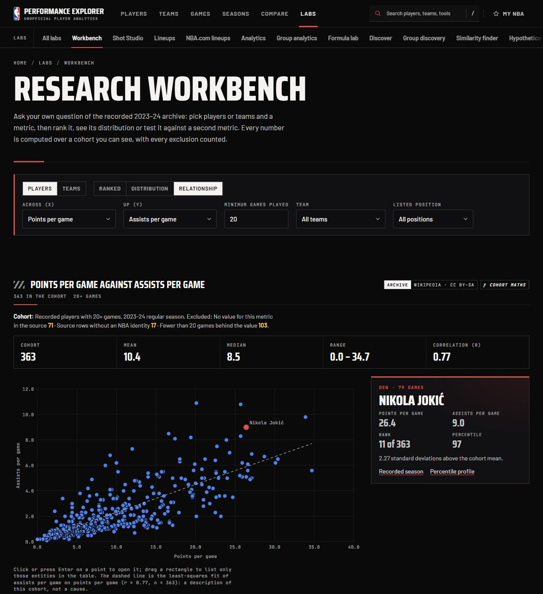
      <br /><sub>Research Workbench · recorded 2023-24 Wikipedia cohort</sub>
    </td>
  </tr>
</table>

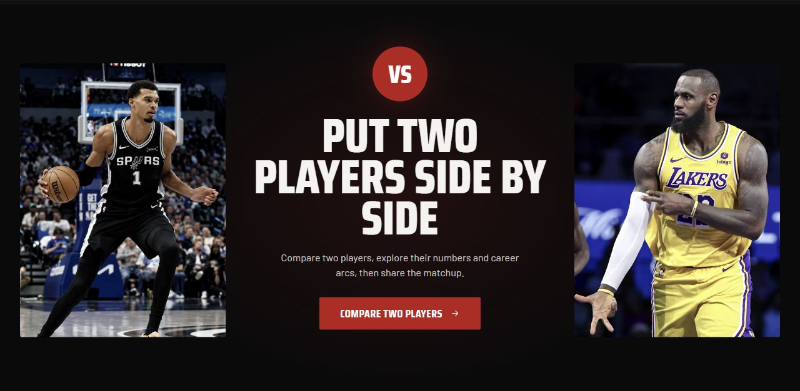

The liquid VS section is an actual rendered browser frame. Pointer motion, recovery and the
reduced-motion/touch fallback are verified separately by the browser regression suite.
[View the queried player-statistics detail](docs/release/screenshots/3.3/03b-player-statistics-desktop.jpg).

</details>

<details>
<summary>View representative mobile layouts</summary>

<table role="presentation">
  <tr>
    <td width="50%" valign="top">
      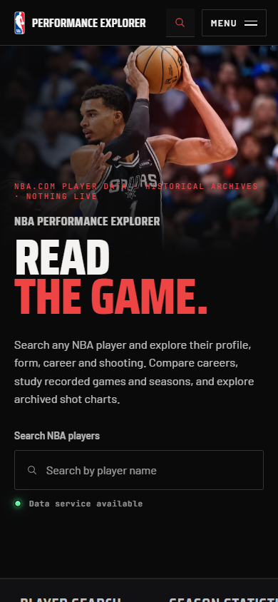
      <br /><sub>Mobile homepage · production acceptance, fixtures disabled</sub>
    </td>
    <td width="50%" valign="top">
      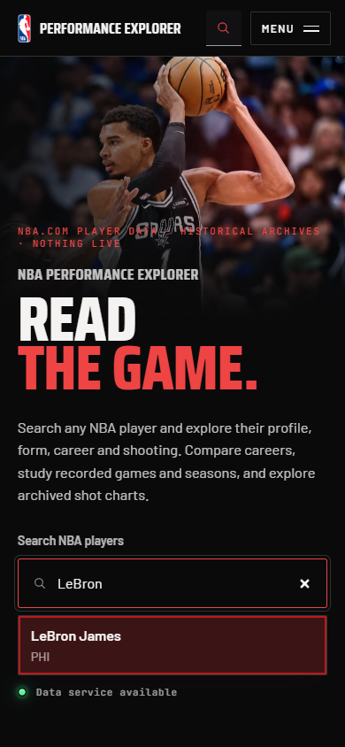
      <br /><sub>Mobile player search · genuine NBA.com result, fixtures disabled</sub>
    </td>
  </tr>
</table>

</details>

These are authentic browser captures of the approved implementation, not mockups. Desktop
and mobile production captures use the live NBA player provider with fixtures disabled;
queried data is not a continuously live feed. Historical results retain their actual dates,
source labels and partial-coverage notices. Every gallery frame uses production configuration
with fixtures disabled. See [capture provenance](docs/release/screenshots/3.3/capture-manifest.json)
and [the publication checklist](docs/release/PUBLICATION_CHECKLIST_3.3.md).

## What 3.3 contains

The complete release combines the capabilities below with NBA player photography and team
marks, responsive page/navigation layouts, player and global search, the historical season
navigator, the interactive liquid VS comparison band, keyboard access and reduced-motion
fallbacks. Player analytics include profiles, season statistics, careers, game logs and research
rooms; source-backed historical tools cover league seasons, teams, recorded games and research.
The scoreboard also requests NBA.com's current schedule when available. Saved research and
stories remain local to the browser. The final homepage preserves its approved headline,
Wembanyama image, transparent search and logo hover.

See [3.3 release notes](docs/release/RELEASE_NOTES_3.3.md),
[the current audit](docs/release/RELEASE_READINESS.md), and
[publication rights](docs/release/RIGHTS_REVIEW_3.3.md).
The screenshots above show the approved 3.3 surface; the
[final visual report](docs/visual-polish/FINAL_POLISH_REPORT.md) retains the detailed design verification.

### Research tools and coverage

- **Playoff Series Film Room** (`/games/series/:id`): any 2024 series game by game, with a
  keyboard-navigable game tape, line scores, running margin, period bars and series
  intelligence. Everything is derived from final and period scores only.
- **Statistical Story Builder** (`/my-nba/stories`): written research with live charts from six
  tools between the reader's notes. Print to PDF, validated JSON export and import, share links;
  stored only in the browser.
- **Research Workbench** (`/lab/workbench`): rank, distribute or relate any recorded player or
  team metric, with quartiles, histogram, fit line and residual departures.
- **Comparison Studio** (`/compare/recorded`) and **Similarity Finder** (`/discover/similar`):
  shared-scale gap board and plain statements; nearest seasons on 2–9 measures the reader
  chooses.
- **Shot Studio** (`/lab/shots`): dots, density, efficiency by points per attempt and source
  zones on a true court projection, with drag-to-select court regions and CSV/SVG export.
- **Seasons and teams:** standings race replay, team season intelligence, the 2024 bracket with
  published seeds, recorded leaders, records and discovery.
- **My NBA:** saved research with notes and collections, recent history (opt-in), motion
  preference, validated import/export.
- **A guided tour** at `/tour`, and global search across players, teams, playoff series and
  games, and tools.
- **New in 3.1:** the **Data Coverage Explorer** (`/explore/coverage`): every dataset's source,
  licence, revision, retrieval dates, counts and field availability by season, plus any NBA.com
  career measured season by season. Also **position filters** on recorded leaders and Workbench
  cohorts, using the positions each 2023–24 team page lists.

- **New in 3.2: the whole league since 1983–84, from NBA.com.** A reconciled 43-season archive
  powers season-aware standings and leaders (totals, per game, per 36, per 100 possessions),
  team pages for any season and franchise, a record book, dated leaderboard movement, player
  record rooms (`/players/:id/records`) and league eras (`/history/eras`). The **scoreboard**
  (`/games`) covers any date plus NBA.com's live schedule, and game pages add box scores and
  play-by-play with runs and lead changes (from 1996–97). Also: **NBA.com lineups and on/off**
  (`/lab/lineups/nba`, from 2007–08), **champions and awards** (`/history/champions`, every
  winner agreed by two sources), a **league shot baseline** in Shot Studio, and a **source
  status board** on the coverage page.

## Data

| Source                                                                            | Use                                                   | Licence                            |
| --------------------------------------------------------------------------------- | ----------------------------------------------------- | ---------------------------------- |
| Wikipedia 2023–24 team pages (30), committed and reconciled                       | Recorded season: 1,219 agreed finals, 639 player rows | CC BY-SA 4.0                       |
| Wikipedia "2024 NBA playoffs" and "2023–24 NBA season" tables, committed snapshot | Bracket, film room, game pages, published standings   | CC BY-SA 4.0                       |
| Wikidata                                                                          | Player identity links                                 | CC0                                |
| Kaggle "NBA Playoff Shots 2018" (13,470 attempts)                                 | Shot Studio                                           | CC0                                |
| NBA.com Stats (on request, backend only)                                          | Player profiles, logs, careers                        | NBA.com terms; may be unavailable  |
| NBA.com Stats league archive, 1983–84 to 2025–26 (committed, 21 MB)               | Standings, leaders, teams, games, records, eras       | NBA.com terms; owner-accepted risk |
| NBA.com live CDN and Stats (on request, cached)                                   | Scoreboard, box scores, play-by-play, lineups         | NBA.com terms; may be unavailable  |
| Wikipedia award articles and NBA.com playerawards (committed facts)               | Award winners agreed by both                          | Facts; CC BY-SA articles linked    |

NBA.com data is used under the owner's accepted risk for this personal, non-commercial project;
no licence or redistribution permission is claimed, and publishing it is the owner's decision.
Every season was checked game by game (player lines must add up to team lines; 11 seasons fail
and are team-only) and reconciled against Wikipedia 2023–24 and BoxScore Lab 2022–23 to 2025–26,
which is used only as a cross-check and never committed
([data integration report](docs/expansion5/DATA_INTEGRATION_REPORT.md)). Fixture data appears only in tests or when explicitly enabled, and is
labelled "DEMO FIXTURES" wherever it shows.

The closeout of the original 134-requirement specification is in
[the final feature matrix](docs/release/FINAL_FEATURE_MATRIX.md): all 134 verified within
their stated scopes (3.1: 87 verified, 33 partial, 13 blocked, 1 deferred), each with evidence
and its remaining limits.

## Run it

Prerequisites: Node.js `>=22.12.0 <23`, npm, Git.

```powershell
git clone https://github.com/lorenzodarioben-lgtm/nba-performance-explorer.git
cd nba-performance-explorer
git checkout release/nba-performance-explorer-3.3
npm ci
```

**Presentation (Windows, production build, no network needed for the historical tools):**

```powershell
powershell -ExecutionPolicy Bypass -File scripts\start-presentation.ps1
```

It opens http://localhost:4310/. Stop it with `scripts\stop-presentation.ps1`. The full
procedure and a 7-minute route are in [the demo runbook](docs/release/DEMO_RUNBOOK.md).

**Development:** `npm run dev` starts the frontend on http://localhost:5173 and the API on
http://localhost:3001 (Vite proxies `/api`). The player provider defaults to fixtures in
development; set `NBA_DATA_PROVIDER=nba-stats` for live NBA.com player data. Backend options
are documented in [backend/.env.example](backend/.env.example), including
`WIKI_ARCHIVE_MODE=live|bundled`.

## Quality

```powershell
npm run validate
npm run check:visual-assets
npm run e2e
```

`validate` runs Prettier, ESLint, a Windows/Linux module-case check, TypeScript, over 1,000
frontend and backend tests (Vitest, Testing Library, MSW, Supertest) and the production builds.
`e2e` runs Playwright smoke and axe accessibility checks on every listed route, desktop and
mobile, against running servers. CI runs `npm run validate` on every push. The latest recorded
results are in [the release readiness report](docs/release/RELEASE_READINESS.md).

## Architecture

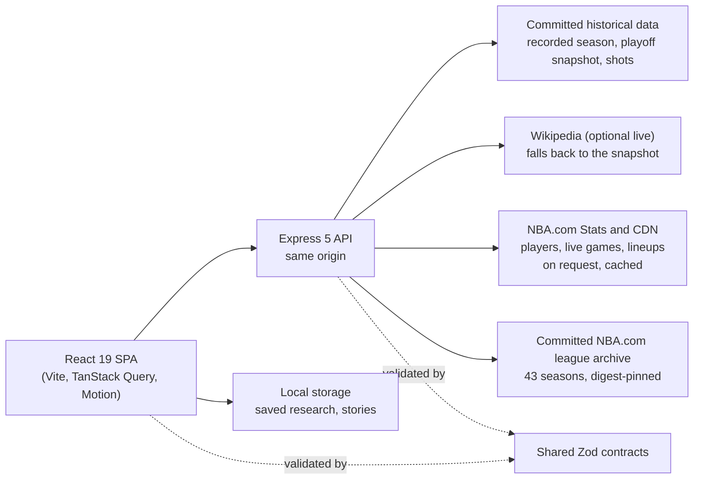

- One Node process serves the API and the built frontend, with SPA fallback for deep links.
- The browser never calls NBA.com or Wikipedia directly; the backend uses fixed, allow-listed
  pages and endpoints with timeouts, and never evades blocking.
- Every response is validated against shared contracts on both sides; personal data never
  leaves the browser.

Stack: TypeScript, React 19, Vite, Tailwind CSS 4, TanStack Query, React Router, Motion,
Express 5, Zod, parse5, Vitest, Testing Library, MSW, Supertest, Playwright, axe-core.

## Production

The public site is one Render web service ([render.yaml](render.yaml)): build
`npm ci && npm run build`, start `node backend/dist/server.js`, health check `/api/health`,
`NBA_DATA_PROVIDER=nba-stats`, fixtures disabled. **Merging into the linked `main` branch
can automatically deploy the release (`autoDeploy: true`); merging needs explicit owner
approval after rights and deployment checks.** NBA.com Stats is an undocumented service and
may block or slow cloud hosts; the player pages then show an unavailable state, never substitute
data. Release and rollback steps: [deployment runbook](docs/release/DEPLOYMENT_RUNBOOK.md).

## Documentation

- [Product overview](docs/release/PRODUCT_OVERVIEW.md)
- [Release readiness](docs/release/RELEASE_READINESS.md)
- [Final feature matrix](docs/release/FINAL_FEATURE_MATRIX.md)
- [Demo runbook](docs/release/DEMO_RUNBOOK.md) and [deployment runbook](docs/release/DEPLOYMENT_RUNBOOK.md)
- [3.2 completion report](docs/expansion5/ORIGINAL_SPEC_COMPLETION_REPORT.md),
  [3.2 data integration report](docs/expansion5/DATA_INTEGRATION_REPORT.md),
  [3.2 execution log](docs/expansion5/EXECUTION_LOG.md)
- [Live handoff](HANDOFF.md), [3.1 verification log](docs/expansion4/VERIFICATION_LOG.md),
  [3.1 data source audit](docs/expansion4/DATA_SOURCE_AUDIT.md), [3.0 verification log](docs/expansion3/VERIFICATION_LOG.md),
  [source notes](docs/expansion3/SOURCE_NOTES.md)
- Original engineering record: [specification](docs/expansion/SHOT_1_MASTER_SPEC.md),
  [archived ledger](docs/expansion/FEATURE_LEDGER.md), [API catalog](docs/expansion/API_CATALOG.md),
  [calculations](docs/expansion/CALCULATIONS.md), [architecture](docs/ARCHITECTURE.md),
  [decisions](docs/DECISIONS.md)

Unofficial project, not affiliated with, endorsed by or sponsored by the NBA.
