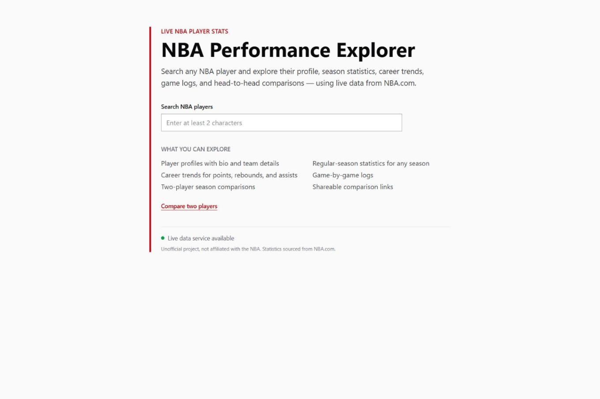
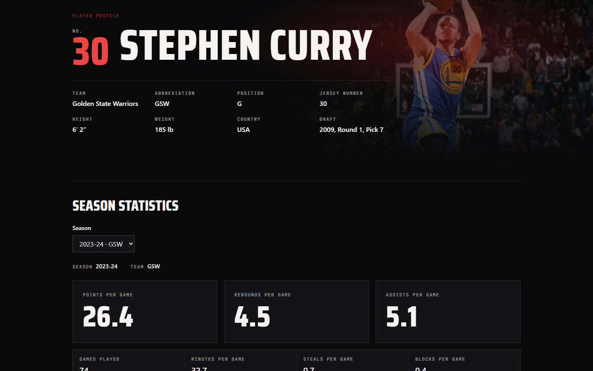
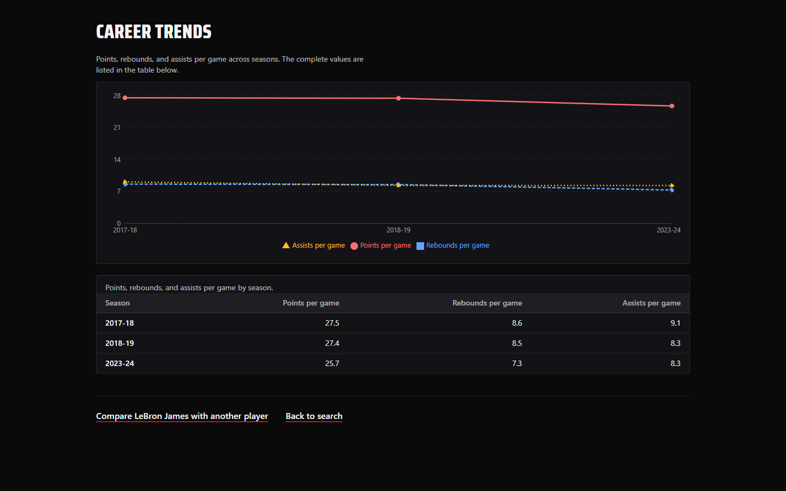
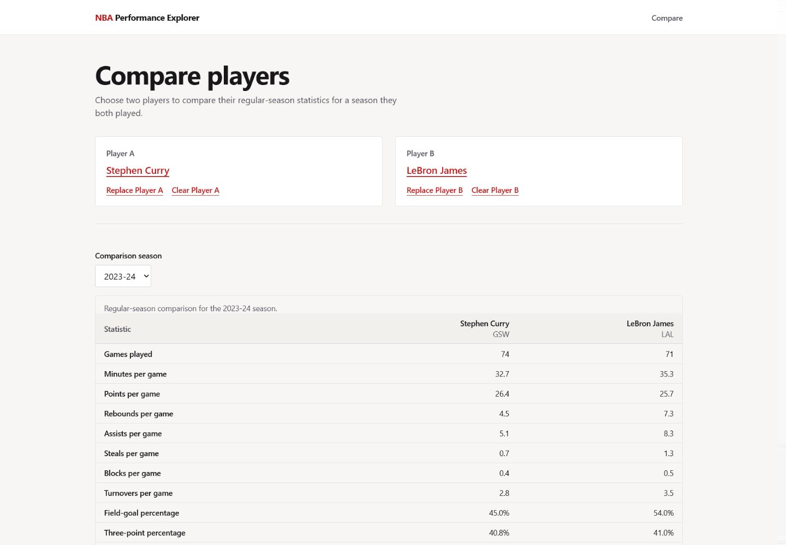
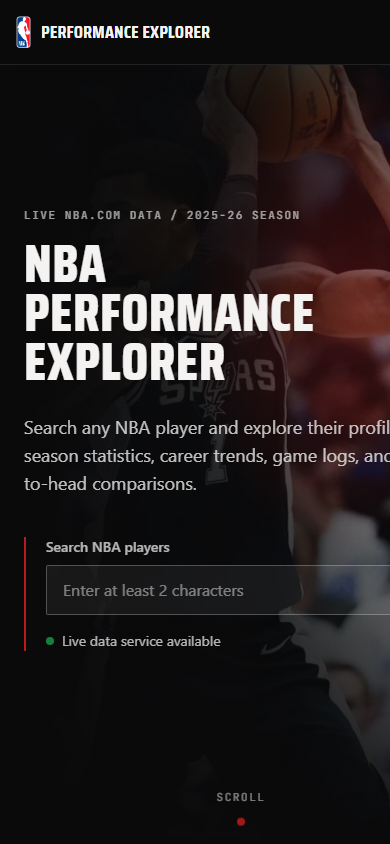
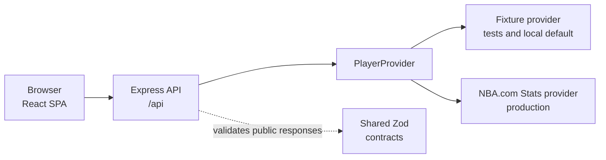

# NBA Performance Explorer

NBA Performance Explorer is a live portfolio web app for searching NBA players,
exploring profiles, season statistics, career trends, game logs, and shareable
two-player comparisons, with production data served from NBA.com through this
project's backend provider.

**Live demo:** https://nba-performance-explorer.onrender.com

The Render free service may need roughly 50 seconds to wake after inactivity. NBA.com
is an external dependency, so live data availability is not guaranteed continuously.

## Screenshots

Captured from the final redesigned app with deterministic fixture data (Stephen Curry and
LeBron James, 2023-24 season).

<a href="https://nba-performance-explorer.onrender.com">
  
</a>

<table role="presentation">
  <tr>
    <td width="50%">
      
      <br /><sub>Player profile identity and bio</sub>
    </td>
    <td width="50%">
      
      <br /><sub>Career-trend chart with an equivalent data table</sub>
    </td>
  </tr>
  <tr>
    <td width="50%">
      
      <br /><sub>Comparison: grouped statistical matchup and career-arc trend</sub>
    </td>
    <td width="50%">
      
      <br /><sub>Responsive mobile home page</sub>
    </td>
  </tr>
</table>

## Project Highlights

- Live NBA player search and profile pages.
- Available-season lists and selected-season statistics.
- Accessible career-trend visualization with an equivalent semantic table.
- Selected-season game logs.
- Shareable two-player comparison URLs.
- Shared Zod contracts for public API responses.
- Deterministic fixture-backed tests for frontend, backend, and contracts.
- Backend-private live NBA.com provider with sanitized empty and error states.
- Single-service Render deployment and GitHub Actions validation.

## Technology Stack

- TypeScript
- React 19
- Vite
- Tailwind CSS
- TanStack Query
- React Router
- Recharts
- Node.js 22
- Express 5
- Zod
- Vitest
- Testing Library
- Mock Service Worker
- Supertest
- ESLint
- Prettier
- GitHub Actions
- Render

## Architecture

The browser calls only this project's Express API. The backend selects a configured
`PlayerProvider`, maps provider-specific data into internal domain models, and validates
public responses with shared Zod contracts. Live NBA.com request details stay
backend-private. The fixture provider keeps local development, tests, and CI
deterministic. A configured live provider never silently falls back to fixtures.



Key boundaries:

- No browser-side NBA.com requests.
- No provider response shapes leak into React components.
- No API keys are required for the current NBA.com provider.
- No proxying, IP rotation, cookie harvesting, CAPTCHA bypass, or other blocking-evasion
  behavior.

## Quality And Testing

The canonical validation command is:

```powershell
npm run validate
```

Validation includes Prettier format checking, ESLint, strict TypeScript checking, all
tests, and production builds for the contracts, frontend, and backend workspaces.

Current verified baseline:

- Base (`cd557e4`) frontend tests: 190
- Base backend tests: 244
- Base total tests: 434
- GitHub Actions runs `npm run validate`
- Automated tests do not make live NBA.com requests

The frontend build currently emits a known Vite/Recharts chunk-size warning; the build
still succeeds.

## Local Development

Prerequisites:

- Node.js `>=22.12.0 <23`
- npm compatible with Node.js 22
- Git

Fresh clone:

```powershell
git clone https://github.com/lorenzodarioben-lgtm/nba-performance-explorer.git
cd nba-performance-explorer
npm ci
npm run dev
```

`npm run dev` builds the shared contracts, then starts both apps:

- Frontend: `http://localhost:5173`
- Backend API: `http://localhost:3001`

The frontend uses relative `/api` requests. In local development, Vite proxies `/api` to
the backend, so CORS configuration is not needed.

Local development defaults to the fixture provider when `NBA_DATA_PROVIDER` is unset.
This keeps the app usable offline and keeps automated tests deterministic. Optional
backend environment variables are documented in [backend/.env.example](backend/.env.example):

- `NBA_DATA_PROVIDER=fixture|nba-stats`
- `NBA_ALLOW_FIXTURE_IN_PRODUCTION=true|false`
- `NBA_STATS_TIMEOUT_MS=10000`
- `NBA_STATS_DIAGNOSTICS=true|false`
- `PORT=3001`

Optional frontend environment:

- `VITE_API_BASE_URL` can point the frontend at another non-secret API origin. Do not put
  secrets in `VITE_` variables because they are exposed to browser code.

Run one app at a time:

```powershell
npm run dev:frontend
npm run dev:backend
```

## Production Configuration

Production is deployed as one Render web service using [render.yaml](render.yaml):

- Build command: `npm ci && npm run build`
- Start command: `node backend/dist/server.js`
- Health check: `/api/health`
- Express serves the built SPA from `frontend/dist`
- Production provider: `NBA_DATA_PROVIDER=nba-stats`
- Fixture fallback disabled: `NBA_ALLOW_FIXTURE_IN_PRODUCTION=false`
- NBA.com timeout: `NBA_STATS_TIMEOUT_MS=10000`

Render supplies `PORT` at runtime. The deployed service uses same-origin frontend and API
requests, so there is no production CORS proxy.

Documented rollback, if the host can no longer reach NBA.com reliably:

```text
NBA_DATA_PROVIDER=fixture
NBA_ALLOW_FIXTURE_IN_PRODUCTION=true
```

That rollback is explicit configuration, not a silent runtime fallback.

## Operational Limitations

This is an unofficial portfolio project and is not affiliated with, endorsed by, or
sponsored by the National Basketball Association. NBA statistics and data are sourced
from NBA.com when the live provider is enabled.

NBA.com Stats is undocumented and unsupported as a public API. It can rate-limit,
block shared cloud-hosting IPs, change schemas, time out, or temporarily return empty
results for individual players. During a production smoke check, one player-specific
career response returned a valid empty result while another player returned complete
season data through the same parser path.

The application handles unavailable data with sanitized empty and error states. It does
not expose raw upstream responses, request headers, cookies, tokens, or provider internals
to the browser, and it does not silently substitute fixture data when live data fails.

## Repository Structure

```text
frontend/             React/Vite app, feature UI, client API code, frontend tests
backend/              Express API, provider boundary, live NBA.com provider, backend tests
packages/contracts/   Shared Zod schemas and API response types
docs/                 Project spec, architecture, decisions, state, and task history
render.yaml           Render Blueprint for the single production web service
.github/workflows/    GitHub Actions CI workflow
```

## 2.0 Engine Branch (Not Deployed)

Shot 1 adds plain functional tools without changing the original home/profile/compare
visuals. After `npm run dev`, open **http://localhost:5173/explore**. New routes:
`/teams`, `/teams/:teamId`, `/players/:playerId/insights`, `/lab/compare`,
`/lab/analytics`, `/my-nba`. Teams currently provide 30 sourced identities; season
rosters/results unavailable. Analytics uses an explicit selected 2–4 player-season
cohort, not league-wide rankings. Game/standings/shot/lineup/history feeds remain gated.

Local default fixtures are prominently marked; raw shooting totals are unavailable
in fixture runtime. Set `NBA_DATA_PROVIDER=nba-stats` before `npm run dev` to use
verified local NBA raw inputs. No API key, billing account or new dependency required;
source usage/access and production-host suitability remain conditional.

The existing four NBA endpoint families and Totals mode passed bounded local checks.
`npm run smoke:free-sources` and `npm run smoke:engine` are opt-in, not CI; the latter
requires the genuine temporary local server described in the operations runbook.
Engine branch `npm run validate` passes 247 frontend + 320 backend = **567 tests**. Current validation/evidence is in the [handoff](HANDOFF.md),
[feature ledger](docs/expansion/FEATURE_LEDGER.md),
[source audit](docs/expansion/FREE_DATA_SOURCE_AUDIT.md),
[API catalog](docs/expansion/API_CATALOG.md) and
[operations](docs/expansion/OPERATIONS.md). The expansion is working but incomplete,
**NOT MERGED / NOT DEPLOYED**; the public demo remains the original production site.

## Further Documentation

- [Project specification](docs/PROJECT_SPEC.md)
- [Architecture](docs/ARCHITECTURE.md)
- [Architecture decisions](docs/DECISIONS.md)
- [Current project state](docs/PROJECT_STATE.md)
- [TASK-010 live provider validation](docs/tasks/TASK-010-live-nba-provider-response-validation.md)
- [TASK-011 portfolio readiness](docs/tasks/TASK-011-portfolio-readiness-and-final-audit.md)
