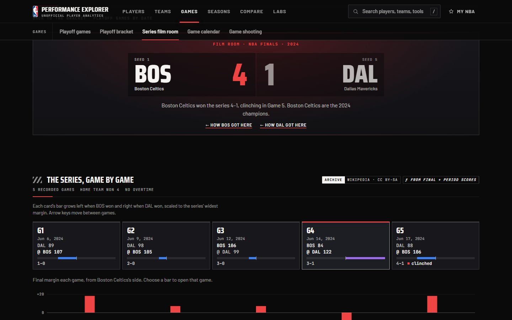
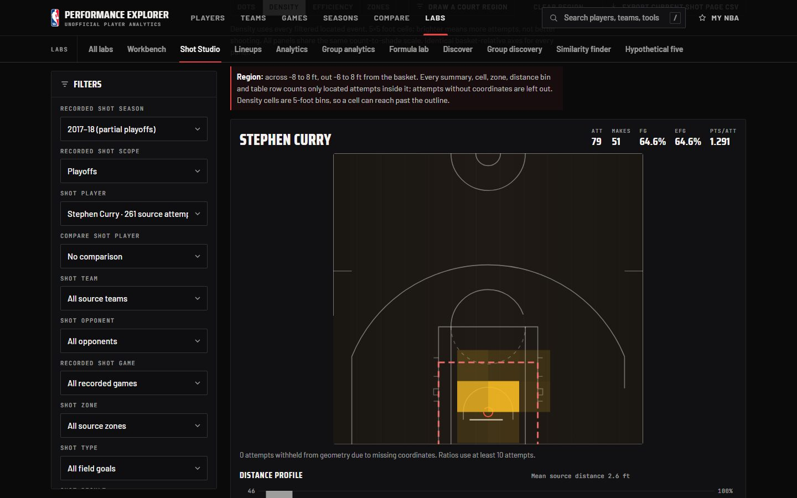
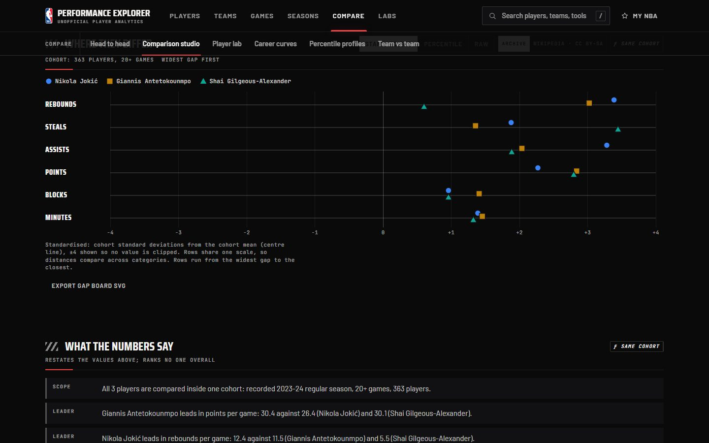
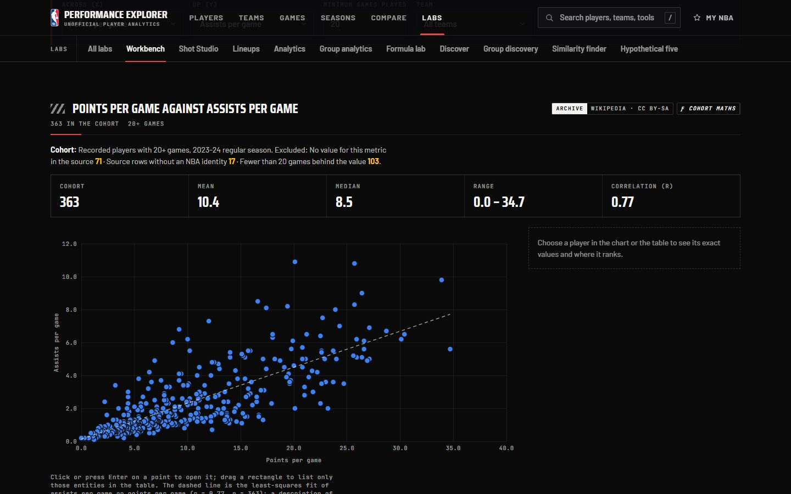
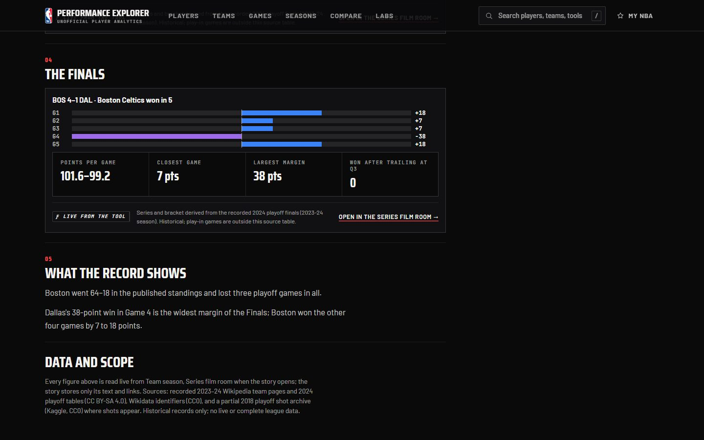
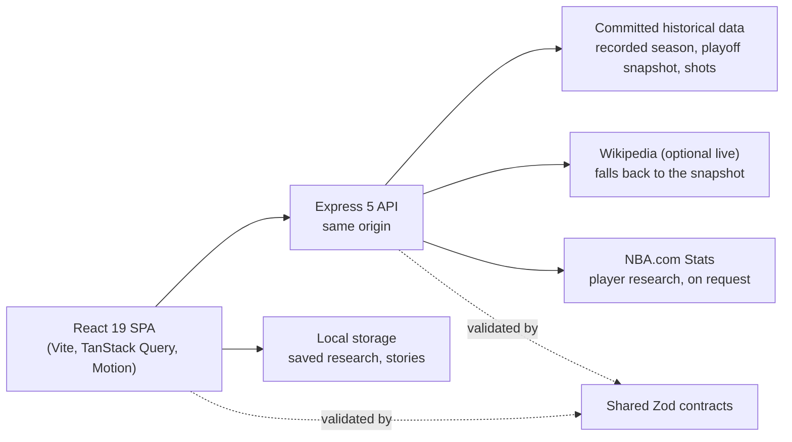

# NBA Performance Explorer

A basketball research site with a broadcast-style "Arena & Film Room" interface: ask a precise
question of real NBA records, see the answer as an interactive chart, and see exactly which
cohort, source and formula produced it.

> **Two versions exist.** The **public site** at https://nba-performance-explorer.onrender.com is
> deployed from `main` and still runs the **original release**. This branch,
> `claude/nba-explorer-3-expansion`, is the **unmerged NBA Performance Explorer 3.1 release
> candidate** (3.0 plus the 3.1 completion sprint) described below. It has not been merged or deployed; see
> [the deployment runbook](docs/release/DEPLOYMENT_RUNBOOK.md) for the planned, owner-approved
> release.



<table role="presentation">
  <tr>
    <td width="50%">
      
      <br /><sub>Shot Studio: drag a region on the court</sub>
    </td>
    <td width="50%">
      
      <br /><sub>Comparison studio: one shared scale, widest gaps first</sub>
    </td>
  </tr>
  <tr>
    <td width="50%">
      
      <br /><sub>Research workbench: relationship with fit line</sub>
    </td>
    <td width="50%">
      
      <br /><sub>Statistical stories: notes between live charts</sub>
    </td>
  </tr>
</table>

All screenshots are of the real application (production build, historical data).

## What 3.0 contains

- **Playoff Series Film Room** (`/games/series/:id`): any 2024 series game by game, with a
  keyboard-navigable game tape, line scores, running margin, period bars and series
  intelligence. Everything is derived from final and period scores only.
- **Statistical Story Builder** (`/my-nba/stories`): written research with live charts from six
  tools between the reader's notes. Print to PDF, validated JSON export and import, share links;
  stored only in the browser.
- **Research Workbench** (`/lab/workbench`): rank, distribute or relate any recorded player or
  team metric, with quartiles, histogram, fit line and residual departures.
- **Comparison Studio** (`/compare/recorded`) and **Similarity Finder** (`/discover/similar`):
  shared-scale gap board and plain statements; nearest seasons on 2–9 measures the reader
  chooses.
- **Shot Studio** (`/lab/shots`): dots, density, efficiency by points per attempt and source
  zones on a true court projection, with drag-to-select court regions and CSV/SVG export.
- **Seasons and teams:** standings race replay, team season intelligence, the 2024 bracket with
  published seeds, recorded leaders, records and discovery.
- **My NBA:** saved research with notes and collections, recent history (opt-in), motion
  preference, validated import/export.
- **A guided tour** at `/tour`, and global search across players, teams, playoff series and
  games, and tools.
- **New in 3.1:** the **Data Coverage Explorer** (`/explore/coverage`): every dataset's source,
  licence, revision, retrieval dates, counts and field availability by season, plus any NBA.com
  career measured season by season. Also **position filters** on recorded leaders and Workbench
  cohorts, using the positions each 2023–24 team page lists.

## Data

| Source                                                                            | Use                                                   | Licence                           |
| --------------------------------------------------------------------------------- | ----------------------------------------------------- | --------------------------------- |
| Wikipedia 2023–24 team pages (30), committed and reconciled                       | Recorded season: 1,219 agreed finals, 639 player rows | CC BY-SA 4.0                      |
| Wikipedia "2024 NBA playoffs" and "2023–24 NBA season" tables, committed snapshot | Bracket, film room, game pages, published standings   | CC BY-SA 4.0                      |
| Wikidata                                                                          | Player identity links                                 | CC0                               |
| Kaggle "NBA Playoff Shots 2018" (13,470 attempts)                                 | Shot Studio                                           | CC0                               |
| NBA.com Stats (on request, backend only)                                          | Player profiles, logs, careers                        | NBA.com terms; may be unavailable |

Historical only: there is no live or current data, no play-by-play, possessions, injuries or
league-wide shot baseline. 2022–23 was audited and **not** added because its source pages failed
the integrity checks. BoxScore Lab's 2023–24 files matched the archive in 3.1 but republish NBA
Stats data under terms that restrict redistribution, so they were not added
([data source audit](docs/expansion4/DATA_SOURCE_AUDIT.md)). Fixture data appears only in tests or when explicitly enabled, and is
labelled "DEMO FIXTURES" wherever it shows.

The closeout of the original 134-requirement specification is in
[the final feature matrix](docs/release/FINAL_FEATURE_MATRIX.md): 87 verified, 33 partial,
13 blocked and 1 deferred (3.0: 83 / 37 / 13 / 1), each with evidence and the reason for any gap.

## Run it

Prerequisites: Node.js `>=22.12.0 <23`, npm, Git.

```powershell
git clone https://github.com/lorenzodarioben-lgtm/nba-performance-explorer.git
cd nba-performance-explorer
git checkout claude/nba-explorer-3-expansion
npm ci
```

**Presentation (Windows, production build, no network needed for the historical tools):**

```powershell
powershell -ExecutionPolicy Bypass -File scripts\start-presentation.ps1
```

It opens http://localhost:4310/. Stop it with `scripts\stop-presentation.ps1`. The full
procedure and a 7-minute route are in [the demo runbook](docs/release/DEMO_RUNBOOK.md).

**Development:** `npm run dev` starts the frontend on http://localhost:5173 and the API on
http://localhost:3001 (Vite proxies `/api`). The player provider defaults to fixtures in
development; set `NBA_DATA_PROVIDER=nba-stats` for live NBA.com player data. Backend options
are documented in [backend/.env.example](backend/.env.example), including
`WIKI_ARCHIVE_MODE=live|bundled`.

## Quality

```powershell
npm run validate
npm run e2e
```

`validate` runs Prettier, ESLint, a Windows/Linux module-case check, TypeScript, about 900
frontend and backend tests (Vitest, Testing Library, MSW, Supertest) and the production builds.
`e2e` runs Playwright smoke and axe accessibility checks on every listed route, desktop and
mobile, against running servers. CI runs `npm run validate` on every push. The latest recorded
results are in [the release readiness report](docs/release/RELEASE_READINESS.md).

## Architecture



- One Node process serves the API and the built frontend, with SPA fallback for deep links.
- The browser never calls NBA.com or Wikipedia directly; the backend uses fixed, allow-listed
  pages and endpoints with timeouts, and never evades blocking.
- Every response is validated against shared contracts on both sides; personal data never
  leaves the browser.

Stack: TypeScript, React 19, Vite, Tailwind CSS 4, TanStack Query, React Router, Motion,
Express 5, Zod, parse5, Vitest, Testing Library, MSW, Supertest, Playwright, axe-core.

## Production

The public site is one Render web service ([render.yaml](render.yaml)): build
`npm ci && npm run build`, start `node backend/dist/server.js`, health check `/api/health`,
`NBA_DATA_PROVIDER=nba-stats`, fixtures disabled. NBA.com Stats is an undocumented service and
may block or slow cloud hosts; the player pages then show an unavailable state, never substitute
data. Release and rollback steps: [deployment runbook](docs/release/DEPLOYMENT_RUNBOOK.md).

## Documentation

- [Product overview](docs/release/PRODUCT_OVERVIEW.md)
- [Release readiness](docs/release/RELEASE_READINESS.md)
- [Final feature matrix](docs/release/FINAL_FEATURE_MATRIX.md)
- [Demo runbook](docs/release/DEMO_RUNBOOK.md) and [deployment runbook](docs/release/DEPLOYMENT_RUNBOOK.md)
- [Live handoff](HANDOFF.md), [3.1 verification log](docs/expansion4/VERIFICATION_LOG.md),
  [3.1 data source audit](docs/expansion4/DATA_SOURCE_AUDIT.md), [3.0 verification log](docs/expansion3/VERIFICATION_LOG.md),
  [source notes](docs/expansion3/SOURCE_NOTES.md)
- Original engineering record: [specification](docs/expansion/SHOT_1_MASTER_SPEC.md),
  [archived ledger](docs/expansion/FEATURE_LEDGER.md), [API catalog](docs/expansion/API_CATALOG.md),
  [calculations](docs/expansion/CALCULATIONS.md), [architecture](docs/ARCHITECTURE.md),
  [decisions](docs/DECISIONS.md)

Unofficial project, not affiliated with, endorsed by or sponsored by the NBA.
