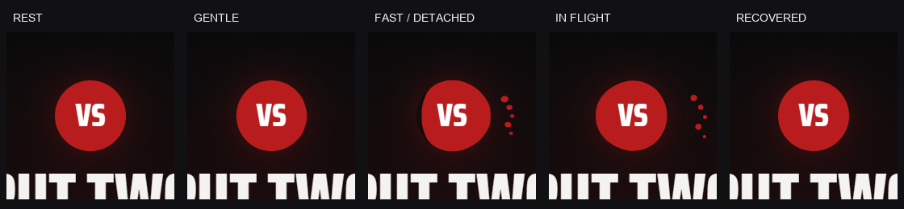

# Homepage micro-polish

17 October 2026 · `codex/nba-explorer-final-polish` · baseline `dafff91`.
Delivery commit: `git log -1 --oneline`. Earlier reports/evidence are preserved below.

The three corrections are restricted to the restored NBA logo hover, the hero photograph
and the homepage search surface. No dependencies or shared combobox behavior changed.

| Correction       | Before                                               | After                                                         |
| ---------------- | ---------------------------------------------------- | ------------------------------------------------------------- |
| Logo hover       | −1px / −3°                                           | −2px / −6°, same 220ms `cubic-bezier(0.2, 0.8, 0.2, 1)`       |
| Photo frame      | `min(59%, 1000px)`                                   | `min(64%, 1120px)`, right anchored                            |
| Horizontal mask  | α .12 at 6%, .42 at 16%, .82 at 28%, 1 at 40%        | α .24 at 5%, .6 at 13%, .9 at 23%, 1 at 34%; α 0 at left edge |
| Hero search fill | Charcoal α .36 idle / .44 hover / .5 focus; 3px blur | Fully transparent in every state; no blur or focus shadow     |

The photograph starts at x800 / 518.4 / 368.6 at the three larger widths, moving
120 / 72 / 51.2px left. The actual source photograph, cover fit, `center 3%` focal point,
bottom fade and desktop shade overlay remain. Wembanyama's face and ball stay clear;
the defender's head, shoulder and arm are more visible. Mobile keeps its existing crop.
The responsive image `sizes` attribute now matches the wider desktop frame.

The search uses a hero-scoped transparent background shorthand to clear the shared
gradient, plus a transparent focus override for the shared focus fill. Hover changes
only the border. Computed checks cover the input, field wrapper, combobox wrapper,
hero-search wrapper and their `::before`/`::after` layers: alpha zero, no background
image, blur or shadow, opacity 1. Thin outline/red focus, label, icon, placeholder and
typed text remain readable. Results retain solid coal `rgb(17, 17, 20)`.
The global search, directory and comparison controls retain their existing surfaces.

| Viewport  | Before                                                     | After                                                     |
| --------- | ---------------------------------------------------------- | --------------------------------------------------------- |
| 1920×1080 | [Home](screenshots/home-micro-polish/before-home-1920.png) | [Home](screenshots/home-micro-polish/after-home-1920.png) |
| 1440×900  | [Home](screenshots/home-micro-polish/before-home-1440.png) | [Home](screenshots/home-micro-polish/after-home-1440.png) |
| 1024×900  | [Home](screenshots/home-micro-polish/before-home-1024.png) | [Home](screenshots/home-micro-polish/after-home-1024.png) |
| 390×844   | [Home](screenshots/home-micro-polish/before-home-390.png)  | [Home](screenshots/home-micro-polish/after-home-390.png)  |

[Before measurements](screenshots/home-micro-polish/before-checks.json) and
[after measurements](screenshots/home-micro-polish/after-checks.json) include focused
states, image geometry and source URLs. The same folder includes focused-search
before/after captures at all sizes; desktop/mobile loading, results, empty/error, keyboard
focus and actual logo-hover evidence. Capture tool: `scripts/capture-home-micro-polish.mjs`.
Run `before` only against the baseline revision; run `after` against the delivered revision.

Actual inspection found no hard photo boundary, horizontal overflow, uncaught errors
or headline-size changes. Logo tests hover the image directly, measure the −2px / −6°
pose, sample the smooth return and compare unchanged logo/nav/search layout rectangles.
Keyboard outline, system/in-app reduced motion and desktop/mobile home navigation pass.
Search checks exercise idle, hover, focus, typed/loading/results, empty/error, Arrow keys,
Enter and Escape with focus retention. Existing regression expectations changed only
where the owner explicitly requested new visual values; new transparency/scope checks
strengthen coverage. Physics assertions remain unchanged.

Validation: **31 focused unit tests and 11 focused browser cases passed**, with one
intentional duplicate mobile headline skip. Final `npm run validate` **exits 0**:
541/541 frontend tests, 532/532 backend tests, formatting, module-case/assets, frontend
and backend types, and both production builds. Lint: zero errors, the same 13 existing
warnings. Separate `npm run check:visual-assets` passes: 401 files, 73 players, 45 marks,
604 archive plus 653 franchise-record team-seasons.

Full `npm run e2e`: **240 passed, 78 skipped, 2 failed** in the initial concurrent run
(14.6 minutes). The two failures were unavailable health status before the logo test
and a 0.2px entrance/layout sample in the comparison check. After validation completed,
`npm run e2e -- --last-failed --workers=1`: **2 passed**, 34.8 seconds. All **242 unique
browser tests pass across these runs**. The 78 skips are 73 duplicate mobile axe checks,
four mouse-only liquid checks on touch and one duplicate four-width headline check.

The initial concurrent validation also hit a frontend link-wait timeout and backend
warm-up timeout. Both clear in the successful sequential full validation. The sandbox
initially prevented focused Vitest cache-file renaming; normal local execution passes.
No timeout, comparison/physics implementation or existing layout assertion was changed.

Limits: Chromium desktop and emulated tablet/mobile verification; no physical-device,
Safari or Firefox certification. Mobile search lies below the photograph and therefore
shows the existing dark page beneath its transparent fill. All approved liquid, archive,
typography, status and other-page implementation remains untouched.

---

# Liquid VS physics 3.0

READY FOR OWNER REVIEW · 17 October 2026 · `codex/nba-explorer-final-polish` · starts from `8fef36c`.
Implementation, bounded visual confirmation, full validation and full browser regression complete.
Implementation checkpoint: `3a4ec0b`.
The commit containing this report update is the delivery commit (`git log -1 --oneline`).
All earlier reports and evidence remain below.

## Cause and simulation change

The previous model selected 2–5 droplets directly from speed, using fixed radii,
even angle spacing, a 900px/s gate and a global 120ms cooldown. Most fast mouse samples
hit the speed cap and replayed the same five-piece fan. Slow contact could not separate.
An 8ms denominator floor also understated the velocity of frequent pointer samples.

The 64-node surface is retained. Actual swept contact length now deposits tensile work
at the downstream crest. Velocity, bounded acceleration, incidence, chord depth and
contact position determine that work and its spatial spread. It persists and relaxes
between samples. Local outward velocity, displacement and neighbour strain determine
which crests can pinch off. Existing waves and stored work carry into subsequent swipes.
There is no speed-to-count mapping or mandatory count.

Each candidate must pay a cohesion/size-dependent separation cost. The same local patch
loses tensile work, outward velocity and some displacement; the main mass recoils in
the boundary normal direction. An unsuccessful neck relaxes and dissipates work too.
This makes droplet size compete with fragment count. Fast movement can release a few
larger pieces or more satellites; slow contact can accumulate enough work for small
detachments. Gentle contact at an already disturbed crest can release residual work,
as verified against an identically seeded surface recovering without that contact.

The production random source is `Math.random`, injectable through the model constructor.
Bounded material variation (±10%), nucleation perturbations and a skewed size distribution
modulate physical conditions. Tests use explicit seeds; identical samples and seeds
reproduce the full node/droplet state. No forced alternation or random spawn-count bucket.

| Parameter / safeguard | Final implementation                                                                                                                                                                                                                |
| --------------------- | ----------------------------------------------------------------------------------------------------------------------------------------------------------------------------------------------------------------------------------- |
| Surface               | Original 64 nodes, neighbour coupling, restoring pressure and damping. Contact impulses scale with travelled distance to reduce sample-count dependence.                                                                            |
| Contact work          | Actual in-body chord fraction × sublinear velocity term × incidence × bounded acceleration influence. Work relaxes at 1.8/s.                                                                                                        |
| Pinch-off             | Positive crest velocity above 10, sufficient local tensile work, cohesion and size-dependent cost; short local refractory periods replace the global cooldown. Eight attempts per evaluation are a safety bound, not a quota.       |
| Size and population   | Radii **1.15–6 CSS px**, skewed toward satellites. **16** preallocated slots; no particle accumulation. Larger pieces require more local work.                                                                                      |
| Momentum              | Moving crest, pointer direction, main-body drift and bounded tangential shear; size-dependent launch. Recoil and measured local mechanical-energy withdrawal accompany separation.                                                  |
| Shape                 | Velocity-aligned ellipse plus small damped capillary wobble; both recover toward round. A **76.5–125ms** neck narrows before free flight.                                                                                           |
| Flight and ending     | Radius-dependent viscous drag, mild gravity (26px/s²), attraction strongest near the main mass, **0.52–1.02s** nominal lifetime. Smooth shrinkage and faster lifetime expenditure beyond 76px; reabsorption occurs inside the body. |
| Runtime               | Existing Canvas 2D / 208px region, DPR cap 2, speed cap 2400px/s, elapsed cap 50ms and substeps up to 120Hz. Reused surface buffers and particle pool; temporary per-node pointer objects and frame callbacks removed.              |
| Idle and access       | No React frame state. Render loop ends at rest; offscreen/hidden-tab pause and cleanup remain. Original static CSS circle for touch, reduced motion and failed canvas. Stationary decorative VS label remains.                      |

## Actual repeated trials

Two focused independent real-mouse Chromium runs each performed **20 slow, 20 medium and 20 fast
swipes** on the unseeded production model. Repositioning follows a perimeter outside
the liquid so it does not add a hidden crossing. Every trial waits for recovery, and
monotonic detachment counters include all newly generated pieces, including short-lived
ones. Counts do not mean simultaneously visible components.

Final focused confirmation:

| Input group     | Actual mean wall speed | Observed count distribution (20 trials)            | Mean count | Mean detached area units |
| --------------- | ---------------------- | -------------------------------------------------- | ---------- | ------------------------ |
| Slow deliberate | 188.8px/s              | 1 × 12; 2 × 8; zero-droplet trials: 0              | 1.40       | 2.375                    |
| Medium          | 441.4px/s              | 2 × 3; 3 × 13; 4 × 4; zero-droplet trials: 0       | 3.05       | 6.112                    |
| Fast            | 1281.5px/s             | 3 × 1; 4 × 6; 5 × 5; 6 × 8; zero-droplet trials: 0 | 5.00       | 18.447                   |

The initial independent fast run ranged **3–7**, with mean 5.00, using the same physics.
The count can repeat; sizes, positions and momentum vary without a rule requiring each
result to differ. Browser automation overhead makes the measured speeds lower than the
requested 220/650/1500px/s. Area units are the sum of squared radii, a relative mass proxy,
not a physical mass measurement. [Final raw trials](screenshots/liquid-physics-3/browser-trials.json),
[initial raw trials](screenshots/liquid-physics-3/browser-trials-initial.json).

The full regression suite repeats a third independent 20-trial group at each speed:
slow counts 1 × 14 / 2 × 6 (mean **1.30**), medium 2 × 1 / 3 × 11 / 4 × 8 (**3.35**),
fast 3 × 1 / 4 × 4 / 5 × 8 / 6 × 5 / 7 × 2 (**5.15**). All three groups have zero
zero-detachment trials. Mean wall speeds are 189.7 / 430.3 / 1263.5px/s. See
[regression raw trials](screenshots/liquid-physics-3/browser-trials-regression.json).

Twenty seeded model trials per group also exercise zeros: very gentle 40px/s and gentle
100px/s each had **20 zero-detachment trials**. At 220px/s there were **two zeros, seventeen
single drops and one double**; medium averaged 3.85 and fast 6.05. Sparse fast crossings
ranged 3–8. Fast edge strokes averaged 1.4 and much less detached area than centre strokes.
Maximum observed flight extent including original droplet radius was 91.68px in those
trials, inside the 104px canvas half-width. See [seeded measurements](screenshots/liquid-physics-3/model-trials.json).

## Browser evidence and performance

Actual mouse sequences cover very slow/gentle contact, slow/medium strokes, fast horizontal,
vertical, diagonal, edge and centre crossings, differing same-speed results and six rapid
strokes while the surface is recovering. The final sequence records 0 / 0 / 1 / 4 droplets
for very slow / gentle / slow / medium; fast horizontal / vertical / diagonal / edge / second
horizontal generate 5 / 3 / 6 / 2 / 4. The repeated sequence generates 37 total over six
strokes, while the active pool stays bounded. These totals are not a 37-particle burst.

The first visual review confirmed varied free masses and necks, but the end-of-stroke
gentle stills missed the active deformation. The confirmation batch captures gentle
mid-contact and three additional same-speed fast examples. The approved original native
circle crop matches pixel-for-pixel at **1920×1080, 1440×900, 1024×900 and 390×844**.
The section dimensions and stationary label/heading/photo positions are preserved;
all four widths have zero page overflow. [Resting comparison](screenshots/liquid-physics-3/rest-baseline-comparison.json).

The final focused **4× CDP CPU throttle** run measured median **16.7ms**, p95 **16.8ms**
frame interval over 229 sampled intervals; 176 canvas draws. A subsequent 300ms settled
observation recorded no additional draws. This synthetic JavaScript throttle includes
capture/instrumentation overhead and does not certify physical laptops, GPUs or touch
hardware. [Motion measurements](screenshots/liquid-physics-3/motion-checks.json).

- [25-second cropped browser recording](screenshots/liquid-physics-3/motion-closeup.webm)
- [Native frame sequence](screenshots/liquid-physics-3/frame-sequence.png)
- [Full browser recording](screenshots/liquid-physics-3/interaction.webm)
- [All native evidence](screenshots/liquid-physics-3)

Reproduce seeded measurements with `npx tsx scripts/measure-liquid-physics.mjs` and resting
captures with `node scripts/capture-liquid-rest.mjs`. The `organic liquid` Playwright tests
record the mouse distributions/video. Set `PW_CHROMIUM_PATH` for an installed browser.
`LIQUID_PHYSICS_EVIDENCE_DIR`, `LIQUID_ARCHIVE_EVIDENCE_DIR` and `POLISH_EVIDENCE_DIR` direct
rerun artifacts elsewhere so the reviewed evidence is preserved.

## Verification, scope and limits

Focused model/static-fallback tests: **17 passed**. The two new browser checks passed in
both visual rounds (mobile intentionally uses the static fallback). The existing sparse
swipe check passed. A legacy pixel test initially sampled before fonts/layout settled,
yielding zero for both strokes; explicit font/network settling fixes the harness. Its
unchanged behavior assertions then passed: slow disturbance 14,259, fast 135,762 and no
idle draws. Full `npm run validate` passed: **541 frontend tests, 532 backend tests**,
formatting, lint (zero errors; same 13 existing warnings), module-case/asset checks,
frontend/backend types and both production builds. Full `npm run e2e` passed:
**238 passed, 78 intentional skips, zero failures**, 7.8 minutes. Skips: 73 duplicate
mobile axe cases, four mouse-only liquid checks on touch and the duplicate mobile
four-width headline check. Final changed-file formatting also passed.
See [validation log](verification/liquid3-validate.txt) and
[focused deterministic tests](verification/liquid3-unit.txt), plus the
[full browser log](verification/liquid3-e2e.txt).

Separate visual-asset verification passed: **401 files, 73 players, 45 marks and 1,257
matched archive/franchise team-seasons** ([asset log](verification/liquid3-assets.txt)). No dependency changes.

Scope stays within `liquidModel.ts`, `LiquidVersus.tsx`, directly related tests, evidence
tooling and these reports. No styles, headline/search, photography, history, navigation,
other pages, backend data, assets or registries changed. No new hook exceptions. Existing
`.claude/` and raw `NBA_ASSETS` remain unstaged. Main is preserved; no PR, merge or deploy.

Compromises: this is a bounded physically inspired 2D model, not a volume-conserving CFD
solver. Satellites can become very small; a swipe need not produce a unique count, and
artistic count ranges are not guarantees. Fixture player API is used for browser checks;
production NBA connectivity and physical devices are outside this verification.

**Next action:** open `http://localhost:5173/`, scroll to the red VS ball, then compare
a slow centre stroke with a fast edge stroke in the running local preview.

---

## Previous liquid 2.0 and archive record (preserved)

# Liquid physics 2.0 and the historical archive

READY FOR OWNER REVIEW · 17 October 2026 · `codex/nba-explorer-final-polish`

This pass starts from `699e5ac`. Checkpoints: `ea38eca` (homepage/liquid) and `4958260`
(archive). The commit containing this report update is the final delivery commit;
resolve it with `git log -1 --oneline`. Earlier reports remain below as history.

## Four delivered improvements

| Request                                   | Result                                                                                                                                                                                                                                                                                                                                                      |
| ----------------------------------------- | ----------------------------------------------------------------------------------------------------------------------------------------------------------------------------------------------------------------------------------------------------------------------------------------------------------------------------------------------------------- |
| Headline 3% smaller than its current size | Every bound of the current `.homehero__line` clamp is multiplied by 0.97: `4.608rem / 14.304vw / 12.432rem` becomes `4.46976rem / 13.87488vw / 12.05904rem`. Browser tests compare against captures from `699e5ac`, not an older historical size. Saira Condensed, white/red, two lines, entrance, paragraph and Wembanyama geometry remain.                |
| More transparent homepage search          | Background alpha is 0.36 instead of 0.58 at rest, 0.44 instead of 0.66 on hover, and 0.50 instead of 0.72 on focus. Blur is 3px instead of 4px. Text/icons retain full opacity; the result dropdown retains opaque coal `#111114`. The scope is `.homehero__search`; masthead and other searches are unchanged.                                             |
| Genuine detachable liquid                 | The existing 64-node wave model now emits bounded liquid masses only on sufficiently energetic, fast boundary crossings. A brief narrowing neck precedes independent flight. Droplets have varied size-dependent momentum, drag, cohesion, gravity, stretching, finite life and smooth disappearance. Rest remains the original native 88px red CSS circle. |
| Whole-page historical archive             | The Kobe/Shaq archival introduction leads into a coherent filter deck, real returned range/count, selectable decade chapters, chronological season spines, licensed research links, a clearly linked source index and save/share controls. Source records, champion entity semantics, missing statements, provenance and detail pages remain intact.        |

Application changes are in `home.css`, `history.css`, `LiquidVersus.tsx`, `liquidModel.ts`,
`HistoryArchive.tsx`, `HistoryPage.tsx` and `SeasonTimeline.tsx`. `ResearchShell.tsx` gains
an optional root class to scope the archive without changing other research pages.
`PRODUCT.md` records only the explicit owner constraints and verified incumbent purpose;
unconfirmed audience/business decisions remain open. No dependencies or production assets changed.

## Liquid architecture and parameters

The proven neighbour tension, restoring pressure, directional impulses and swept-pointer
influence remain. Reusable node history/outline buffers and a preallocated droplet pool
avoid per-frame object churn. Canvas changes only the contour and liquid masses; original
red, glow, position and crisp stationary HTML VS remain authoritative.

| Safeguard / physical influence | Implementation                                                                                                                                                                                                                               |
| ------------------------------ | -------------------------------------------------------------------------------------------------------------------------------------------------------------------------------------------------------------------------------------------- |
| Detachment                     | Pointer speed at least **900 CSS px/s**, actual downstream circle intersection, influence above 0.65, model energy above 12 and local outward crest velocity at least 65. Near misses and gentle passes cannot emit droplets.                |
| Count and size                 | **12 active maximum**; 2–5 per eligible crossing according to speed. Radii 2.1–4.4 CSS px. Deterministic variation, without random explosions or decorative emitters.                                                                        |
| Mechanical connection          | Launch follows swipe and boundary direction, scaled by radius. Separation reduces nearby crest velocity to 62% and applies 2 units of recoil per emitted mass. A neck narrows over the first 75ms.                                           |
| Flight                         | Drag coefficient 3.2/s; gravity 26 px/s²; inward cohesion 85 px/s² after 120ms. Velocity-aligned stretch relaxes; radius shrinks smoothly during the last 40% of life.                                                                       |
| Bounds                         | Lifetime **0.64–0.82 seconds**; flight culled beyond 94px from centre; emission cooldown 120ms. The transparent 208px canvas gives room around the unchanged 88px host. Description, CTA and page width stay untouched.                      |
| Integration                    | Stable substeps at up to 120Hz, elapsed cap 50ms, DPR cap 2, pointer speed cap 2400px/s. No React state changes per frame.                                                                                                                   |
| Idle / fallbacks               | The loop ends after surface energy and droplets settle; reset clears the pool. Offscreen/hidden-tab stops, passive pointer listeners, observers and cleanup remain. Touch, reduced motion and canvas failure use the original static circle. |

Actual Chromium mouse tests cover gentle and medium movement, sparse fast horizontal
crossing, fast diagonal crossing, repeated swipes, leaving the area, recovery, offscreen
pause, reduced motion and idle draw counts. Canvas connected-component analysis verifies
detached pixels, rather than relying only on particle counters. The reviewed sequence
contains **five detached components** on fast frames and no droplets on gentle movement.
The label, heading and photograph positions remain fixed.

The 4× CDP CPU-throttled focused run measured median frame interval **16.7ms**, p95 **33ms**,
with no new canvas draws during the final idle observation. This is a synthetic JavaScript
throttle, not physical laptop/GPU certification; screenshot/measurement work is included.
See [motion measurements](screenshots/liquid-archive/motion-checks.json).

The original circle crop is **pixel-identical at all four widths** against the archived
`5cc481a` screenshots: [resting comparison](screenshots/liquid-archive/resting-baseline-checks.json).

## Archive decisions and source honesty

The former small photo/plain form/dense all-decade grid becomes an editorial photo stage,
an exploration deck and a focused decade chapter. The most recent ten-season decade in
the response opens first; otherwise the first available chapter opens. Selecting a decade
changes only the view, never URL filters or response contents. The rail keeps the active
decade visible on mobile. Seasons run chronologically down each desktop column and in one
mobile spine; previous/next decade buttons and individual season links are keyboard usable.

The overview count and earliest/latest labels come only from `data.seasons`. Champion
labels remain Wikidata statements; missing winners say so. The `from`, `to` and `champion`
query semantics, validation, entity-ID pattern and native form constraints are preserved.
Apply/reset and the share URL stay synchronized. The full table is one native disclosure
away through both a timeline anchor and a named source-index section. It retains captions,
row/column headers, original labels and source links, with an accessible horizontal scroll
region on mobile. Source coverage and limitations remain outside the disclosure.

`/history/:season` retains its heading, champion summary, source notes, share URL and
query-preserving previous/next navigation. The 2023–24 research hub is retained. The
Kobe/Shaq image is used only for the general index, never as a particular season's event.
The shared data model, backend, registries, Scoreboard/Compare headers and other layouts
are unchanged.

## Visual review and evidence

Before captures are from the actual `699e5ac` state. Final captures cover `/`, `/history`
and `/history/2023-24` at **1920×1080, 1440×900, 1024×900 and 390×844**. All 12 combinations
have one h1, zero horizontal page overflow and no console/uncaught browser errors.
See [before](screenshots/liquid-archive/before-checks.json) and
[after](screenshots/liquid-archive/after-checks.json) measurements.

The first visual pass identified a too-dark tablet photo fade, timeline dash encoding and
an offscreen active mobile decade. One refinement batch corrected them and confirmed the
four widths. The liquid launch was also refined from an even fan to size-dependent flight
and a short neck. No open-ended polish loop or new imagery was introduced.

| Evidence                     | Before                                                              | After                                                                                                                                                                                                                                                        |
| ---------------------------- | ------------------------------------------------------------------- | ------------------------------------------------------------------------------------------------------------------------------------------------------------------------------------------------------------------------------------------------------------ |
| Homepage, desktop            | [1440](screenshots/liquid-archive/before-home-1440.png)             | [1440](screenshots/liquid-archive/after-home-1440.png)                                                                                                                                                                                                       |
| Homepage, mobile             | [390](screenshots/liquid-archive/before-home-390.png)               | [390](screenshots/liquid-archive/after-home-390.png)                                                                                                                                                                                                         |
| Entire historical archive    | [1440](screenshots/liquid-archive/before-history-1440.png)          | [1440](screenshots/liquid-archive/after-history-1440.png)                                                                                                                                                                                                    |
| Mobile archive               | [390](screenshots/liquid-archive/before-history-390.png)            | [390](screenshots/liquid-archive/after-history-390.png)                                                                                                                                                                                                      |
| Wide archive                 | [1920](screenshots/liquid-archive/before-history-1920.png)          | [1920](screenshots/liquid-archive/after-history-1920.png)                                                                                                                                                                                                    |
| Tablet archive               | [1024](screenshots/liquid-archive/before-history-1024.png)          | [1024](screenshots/liquid-archive/after-history-1024.png)                                                                                                                                                                                                    |
| Season detail / retained hub | [1440](screenshots/liquid-archive/before-season-1440.png)           | [1440](screenshots/liquid-archive/after-season-1440.png)                                                                                                                                                                                                     |
| Original resting section     | [Before](screenshots/liquid-archive/before-comparison-1440.png)     | [After](screenshots/liquid-archive/after-comparison-1440.png)                                                                                                                                                                                                |
| Search interaction           | [Earlier hero](screenshots/liquid-archive/before-home-1440.png)     | [Idle](screenshots/liquid-archive/search-idle-desktop.png), [focus](screenshots/liquid-archive/search-focus-desktop.png), [loading](screenshots/liquid-archive/search-loading-desktop.png), [results](screenshots/liquid-archive/search-results-desktop.png) |
| Detailed records             | [Original page](screenshots/liquid-archive/before-history-1440.png) | [Desktop index open](screenshots/liquid-archive/archive-index-open-desktop.png), [mobile](screenshots/liquid-archive/archive-index-open-mobile.png)                                                                                                          |

All native files, including the other viewport captures and individual motion frames,
are in [`screenshots/liquid-archive`](screenshots/liquid-archive). Reproduce page captures
with `node scripts/capture-liquid-archive.mjs after` while the fixture-backed app runs.
`PW_CHROMIUM_PATH` selects an installed browser. `e2e/liquid-archive.spec.ts` captures actual
mouse and keyboard interaction; `LIQUID_ARCHIVE_EVIDENCE_DIR` lets full reruns preserve
the reviewed captures. `POLISH_EVIDENCE_DIR` does the same for the earlier regression suite.

Independent Impeccable finish review: **ship**, no material fixes. The review checked
source and all required screenshots; it did not independently rerun browser tests.
The documenter confirmed preservation of incumbent tokens/components and wrote no design
metadata. Existing absent DESIGN.md/design.json were left as pre-existing metadata gaps,
without inventing a global system change. No new hook suppressions were added.

## Verification and limits

Affected component/model tests: **44 passed**. The final homepage/model checkpoint also
passed **35/35** after the last physical refinement. Focused browser suite: **19 passed,
3 intentional skips, zero failures**. Full `npm run validate` passed: **534 frontend tests
and 532 backend tests**, formatting, module-case/asset checks, frontend/backend types and
production builds. Lint has zero errors and the same 13 existing warnings.
Full `npm run e2e` passed: **236 passed, 76 intentional skips, zero failures**, 8.7 minutes.
Skips are 73 duplicate mobile axe cases, two mouse-only physics cases on touch and the
duplicate mobile four-width headline check. See the
[validation log](verification/liquid-archive-validate.txt) and
[full browser log](verification/liquid-archive-e2e.txt). Final formatting also passed.
Separate asset integrity check passed: **401 files, 73 players, 45 marks and 1,257 matched
team-seasons** ([asset log](verification/liquid-archive-assets.txt)). No dependency changes,
so no dependency/security scope was introduced.

Browser checks use the explicit fixture player provider and existing source-backed
archives. Fixture history tests visibly identify their DEMO provenance; screenshots of
the archive use the actual source response. NBA.com production connectivity and physical
touch/GPU devices were not certified. The liquid is a bounded physically inspired
surface/droplet simulation, not a volume-conserving fluid solver.

**Next action:** open the running local preview at `http://localhost:5173/history` for
owner review. The fixture backend and existing frontend remain available; use `npm run dev`
to restart the app if needed later. No merge, deployment or PR.

---

## Previous homepage correction record (preserved)

# Homepage refinement — owner correction pass

READY FOR OWNER REVIEW · 17 October 2026 · `codex/nba-explorer-final-polish`

This focused pass starts from `bfb241c` and addresses the four subsequent homepage
corrections. The commit containing this report update is the delivery commit; resolve it
with `git log -1 --oneline`. The earlier eleven-item polish record is retained below.

## Changes and fidelity

| Correction                        | Implementation                                                                                                                                                                                                                                                                                                                                                                                                                                                   |
| --------------------------------- | ---------------------------------------------------------------------------------------------------------------------------------------------------------------------------------------------------------------------------------------------------------------------------------------------------------------------------------------------------------------------------------------------------------------------------------------------------------------- |
| Approved home comparison restored | `home.css` restores the original 88 × 88px native CSS circle, `#b91c1c` fill, white 40px Saira Condensed VS and `0 0 48px var(--red-glow)` shadow from `5cc481a`. The section, Wembanyama/LeBron imagery, relative geometry, line breaks, copy, button and hover/focus styles are unchanged. No Kyrie image appears in this section.                                                                                                                             |
| Refined homepage search           | Homepage-scoped rules use translucent charcoal at 58% opacity, a 1px restrained border, 3px corners, 16px icon, 54px input height and a modest 4px backdrop blur. Hover and focus retain transparency and visible edges. The homepage placeholder is “Search by player name”; the shared combobox keeps its existing default elsewhere. Search queries, states, keyboard navigation and selection are unchanged. Masthead and other search styles are untouched. |
| Slightly wider visible hero bleed | Earlier opacity stops in both horizontal masks and a lighter, earlier horizontal shade reveal more detail to the left. Image frame width, source, object-fit, focal point, responsive assets and crop are unchanged. The previously approved 4% headline reduction and existing motion remain. Mobile retains its original bottom mask and image frame.                                                                                                          |
| Smaller solid status core         | The exact `#50f493` core is now a centred 7px pseudo-element: 30% smaller in diameter. Its inset highlight moves with it. The existing 10px indicator footprint carries the same outer shadows; the 20px ring, colour, opacity, easing and 2.8-second timing are unchanged. Connecting, unavailable and reduced-motion logic are untouched.                                                                                                                      |

Relevant application files: `frontend/src/design/home.css`,
`frontend/src/features/foundation/LiquidVersus.tsx`, `FoundationPage.tsx`,
`frontend/src/features/player-search/PlayerSearch.tsx` and `PlayerCombobox.tsx`.
No dependency, registry, NBA data, other-page layout or deployment changes.

## Liquid interaction preserved

`liquidModel.ts` is unchanged. The same 64-node velocity-sensitive, directional surface
simulation supplies only the contour. Canvas now uses the original flat red with no
specular lighting, extra halo or texture. During interaction the CSS fill gives way to
that contour; at rest, the native original CSS circle takes over exactly. The white
HTML label is stationary. Bounded integration, swept pointer bounds, passive listeners,
DPR cap, idle stop, offscreen/hidden-tab stop and cleanup remain.

The real Chromium mouse check measured slow/fast deformation of **37,981 / 202,056**
alpha-difference units (5.32×) in the focused run. It also verifies no movement in the
VS label, heading or images, recovery to the original CSS surface, no idle drawing,
whole-object cursor jumps, offscreen pause, reduced motion and the working comparison
CTA. The unit physics tests cover reversed direction and return to the circular boundary.
Touch and reduced motion use the original static circle; a missing canvas also falls back.

## Browser comparison and evidence

Captured the working pre-correction state, the revised homepage and the actual archived
`5cc481a` comparison in Chromium at **1920 × 1080, 1440 × 900, 1024 × 900 and 390 × 844**.
The archived source used the same public assets and fixture API. Its temporary source
copy and asset/dependency junctions were removed after capture.

All measured comparison geometry and styles match the baseline at every width. The
88px circle pixels match exactly at 1920, 1440 and 1024px. At 390px, an element-screenshot
crop rounds one pixel differently; after accounting for that offset, mean channel
difference is 0.000904 on a 0–255 scale. Whole-section images are pixel-identical at
1920 and 1024px. At 1440px only the LeBron image has minor browser raster differences;
at mobile the crop origin differs by one pixel. These are capture differences, with
identical measured component geometry. See [comparison measurements](screenshots/home-refinement/baseline-comparison.json).

All four homepage sizes were visually reviewed: the hero face remains dominant, the
headline legible, the feather smooth, search text and results readable, and the smaller
LED equally lively. Each size has zero horizontal page overflow and no console or
uncaught page errors. At a paused 1.4-second pulse phase, the outer shadow and ring
computed values are exactly unchanged at all four widths.

All before/after files are in [`screenshots/home-refinement`](screenshots/home-refinement).
Each viewport has hero, empty/focused/typed/results search, status and comparison captures.

| Evidence                  | Before / approved                                                                                                                                         | After                                                                      |
| ------------------------- | --------------------------------------------------------------------------------------------------------------------------------------------------------- | -------------------------------------------------------------------------- |
| Hero, 1440px              | [Before](screenshots/home-refinement/before-hero-1440.png)                                                                                                | [After](screenshots/home-refinement/after-hero-1440.png)                   |
| Hero, 1920px              | [Before](screenshots/home-refinement/before-hero-1920.png)                                                                                                | [After](screenshots/home-refinement/after-hero-1920.png)                   |
| Hero, tablet              | [Before](screenshots/home-refinement/before-hero-1024.png)                                                                                                | [After](screenshots/home-refinement/after-hero-1024.png)                   |
| Hero, mobile              | [Before](screenshots/home-refinement/before-hero-390.png)                                                                                                 | [After](screenshots/home-refinement/after-hero-390.png)                    |
| Empty search              | [Before](screenshots/home-refinement/before-search-empty-1440.png)                                                                                        | [After](screenshots/home-refinement/after-search-empty-1440.png)           |
| Focused search            | [Before](screenshots/home-refinement/before-search-focused-1440.png)                                                                                      | [After](screenshots/home-refinement/after-search-focused-1440.png)         |
| Typed search              | [Before](screenshots/home-refinement/before-search-typed-1440.png)                                                                                        | [After](screenshots/home-refinement/after-search-typed-1440.png)           |
| Open results              | [Before](screenshots/home-refinement/before-search-results-1440.png)                                                                                      | [After](screenshots/home-refinement/after-search-results-1440.png)         |
| Core and preserved halo   | [Before](screenshots/home-refinement/before-status-1440.png)                                                                                              | [After](screenshots/home-refinement/after-status-1440.png)                 |
| Home comparison           | [Before correction](screenshots/home-refinement/before-comparison-1440.png), [approved 5cc481a](screenshots/home-refinement/approved-comparison-1440.png) | [Restored](screenshots/home-refinement/after-comparison-1440.png)          |
| Actual cursor interaction | [Original resting circle](screenshots/home-refinement/approved-comparison-1440.png)                                                                       | [Moving contour](screenshots/home-refinement/after-cursor-interaction.png) |

Reproduce working/final captures with the fixture backend running:
`node scripts/capture-home-refinement.mjs before` or `after`. The `approved` phase expects
an archived `5cc481a` frontend on port 5174. Set `PW_CHROMIUM_PATH` for a non-default browser.
`e2e/final-polish.spec.ts` accepts `POLISH_EVIDENCE_DIR` so new runs preserve the earlier
pass's historical captures.

## Verification and boundaries

Focused component/physics tests: **31/31 passed**. Focused browser suite: **13 passed,
1 intentional touch skip, zero failures**. `npm run validate` completed with exit 0:
formatting, lint (zero errors, the same 13 existing warnings), module casing, visual assets,
TypeScript, **527 frontend tests**, **532 backend tests** and both production builds passed.
The separate `npm run check:visual-assets` passed: 401 files, 73 players, 45 team marks and
1,257 matched team-seasons. `npm run e2e` completed with exit 0: **230 passed,
74 intentionally skipped, zero failed**, in 6.9 minutes. Skips are the 73 duplicate
mobile axe cases and the desktop-only mouse simulation on touch. The full-run mouse
check recorded slow/fast disturbance of 27,631 / 213,533, with idle rendering stopped.
[Validation log](verification/home-refinement-validate.txt),
[asset log](verification/home-refinement-assets.txt),
[E2E log](verification/home-refinement-e2e.txt).

No new hook suppressions. The three previously triaged baseline side accents remain
intentional and retain their existing narrow file-scoped exceptions; this pass does not
modify them or their configuration.

Verification uses the explicit fixture provider and bundled archives, not live NBA.com
connectivity. Hardware-specific touch/GPU performance was not measured. The liquid remains
a bounded surface-wave simulation. Main, other branches, source imagery, dependencies,
route structure and deployment configuration are unchanged. No merge, deployment or PR.

**Next action:** review the four homepage corrections on this feature branch, starting with
the resting VS comparison and then a gentle/fast mouse pass through the circle.

---

## Previous cinematic polish record (preserved)

# NBA Performance Explorer — final cinematic polish

READY FOR OWNER REVIEW · 17 October 2026 · `codex/nba-explorer-final-polish`

Implementation HEAD: `07055db`. Based on the verified `claude/nba-explorer-3-ux-polish`
HEAD `5cc481ab8c3b94e02dcf990769d80c00fc3be881`. The evidence/documentation commit follows
this implementation commit; `git log -1` identifies the final delivery HEAD.

## Delivered improvements

| #   | Requested improvement                                     | Implementation and relevant files                                                                                                                                                                                                                                                                                                                                                                                                                                                                                                                                                                        |
| --- | --------------------------------------------------------- | -------------------------------------------------------------------------------------------------------------------------------------------------------------------------------------------------------------------------------------------------------------------------------------------------------------------------------------------------------------------------------------------------------------------------------------------------------------------------------------------------------------------------------------------------------------------------------------------------------- |
| 1   | Wembanyama composition and feathered left edge            | `home.css` owns the complete geometry. Removed the later 106% width / 6% inset override from `assets.css`; desktop image fills a 59vw, maximum 1000px frame without an inset edge. A multi-stop horizontal mask feathers the real source boundary; the lower mask remains. At 1440 × 900, the geometric crop retains approximately 90% of the original height, versus 81% before feathering in the baseline. The 1199 × 1312 source, responsive registry, facial focal point, pointer depth, reveal and scroll motion remain. Mobile keeps its original 104% framing. No source photography was altered. |
| 2   | Slightly smaller READ THE GAME.                           | Every bound of `.homehero__line`'s clamp is multiplied by 0.96: a 4% reduction at every viewport. Same Saira Condensed, line breaks, weight, colours and reveals.                                                                                                                                                                                                                                                                                                                                                                                                                                        |
| 3   | Shorter homepage description                              | `FoundationPage.tsx` uses the exact supplied replacement. Research source notes are preserved.                                                                                                                                                                                                                                                                                                                                                                                                                                                                                                           |
| 4   | Larger logos on all 30 cards                              | `TeamsPage.tsx` requests 62px marks instead of 48px: 29% greater linear size, using the high-resolution mark variant. `assets.css` retains contain sizing, reserves two lines for names and uses uniform grid rows. All thirty marks, especially GSW, Houston, Spurs, Lakers, Clippers and Jazz, were reviewed and measured without identity overlap. Recorded records and season-aware mappings remain.                                                                                                                                                                                                 |
| 5   | Premium search controls                                   | `shell.css` and `PlayerCombobox.tsx` introduce a shared icon rail, restrained surface, open-sided geometry, bottom rule and precise focus treatment. Navigation is 38px; research fields 54px; Arena fields 60px. The shortcut sits behind a hairline divider. Compact navigation becomes icon-only at tablet widths. Homepage, player landing and comparison fields inherit the same accessible combobox. No API or search-state changes.                                                                                                                                                               |
| 6   | Three distinct cinematic headers and no Pictured captions | Scoreboard: horizontal broadcast window, lower title strap, red edge, Kawhi visible above the mobile title. History: warm inset archive print, asymmetrical title and timeline ticks. Compare: diagonal matchup photograph and red seam leading toward the selectors. Changes are in `league.css`, `history.css`, `compare.css` and the corresponding page components. Descriptive captions are removed; scene alt metadata and provenance documentation remain.                                                                                                                                         |
| 7   | More visible confirmed-service LED                        | `home.css`: 10px green core, layered halo reaching 25px, 2.8-second breathing cycle and a separate soft ring. Neutral connecting and unavailable states are unchanged and tested. Only a validated health response produces green.                                                                                                                                                                                                                                                                                                                                                                       |
| 8   | More noticeable brand feedback                            | `shell.css`: a short 40px red underline and controlled mark brightening. Fine-pointer hover is gated; keyboard focus has an outline and the same accent. No masthead dimensions move; reduced motion resolves immediately.                                                                                                                                                                                                                                                                                                                                                                               |
| 9   | Interactive liquid VS ball                                | New `LiquidVersus.tsx` and `liquidModel.ts`: real velocity-sensitive linked surface simulation, described below. Resting object and existing comparison composition remain 88px.                                                                                                                                                                                                                                                                                                                                                                                                                         |
| 10  | Compact no-photo player heroes                            | `PlayerProfileHero.tsx` uses the verified ID registry and handles actual image-load failure. Scoped `phero--plain` rules in `player.css` place the name, jersey, metadata and actions in an editorial court composition. Terance Mann (`1629611`, a real player with no registry photograph) is the deterministic example. At 1440px the hero shrinks from 738px to 408px; at 1920px from 860px to 408px. At 390px it is 493px versus the photographic hero's unchanged 715px. No substitute portrait or silhouette.                                                                                     |
| 11  | Seven-row table previews                                  | `RowCollapse.tsx` defaults to seven. Both `PlayerGameLog.tsx` and `PlayerCareerTrends.tsx` use that default. Seven or fewer rows show naturally; eight or more get the disclosure. Hidden attributes, accurate counts, gradient fade, native button focus, expansion and chart-triggered reveal remain. Other tables are unaffected.                                                                                                                                                                                                                                                                     |

## Liquid surface architecture

- 64 radial surface nodes carry displacement and velocity. Restoring stiffness, neighboring
  surface tension, damping and mean-displacement pressure recover the circular resting shape.
- Pointer events sweep a line segment through the surface, avoiding missed fast swipes.
  Distance divided by event time controls impulse strength; direction controls drag and recoil.
  A narrow pressure crest and negative wake create local ripples alongside broad displacement.
- Canvas 2D draws a smooth quadratic contour with a rich red body, meniscus, reflected light
  and restrained halo. The white VS is separate HTML, keeping its reading position stable.
- Bounded integration substeps are no larger than 1/120 second; requestAnimationFrame paints at the display
  cadence. Displacement, drift and velocity are clamped; no unbounded particles or new libraries.
- Rendering starts on disturbance and ends below a small energy threshold. IntersectionObserver
  stops offscreen work; document visibility stops hidden-tab work. Observers and passive pointer,
  scroll and resize listeners are removed on unmount. Geometry is cached between layout events.
- Canvas is capped at 2× device pixel ratio. Coarse pointers, reduced motion (system or app),
  missing canvas, context failure and drawing failure retain an attractive static circle.
- This is a surface-wave approximation, not a volumetric fluid solver. There are no detached
  droplets. This keeps the effect localized and inexpensive without moving selectors or photos.

The final full-suite real-pointer test measured slow-swipe alpha disturbance of 38,751 versus 208,624
for a fast swipe, about 5.4× greater. It verifies recovery, zero resting canvas redraws,
offscreen pause, reduced-motion fallback and the comparison CTA. Physics unit tests separately
compare equal paths at different speeds, direction, damping, bounds and invalid samples.

## Browser evidence

Screenshots live in [`screenshots/final`](screenshots/final). Overview sheets: [1920px](screenshots/final/review-1920.jpg), [1440px](screenshots/final/review-1440.jpg), [1024px](screenshots/final/review-1024.jpg), [390px](screenshots/final/review-390.jpg). `before-*` is the actual
`5cc481a` interface. Long-table before captures were taken from a temporary archived copy of
that commit, using the same expanded, explicitly labelled DEMO fixtures as the after captures;
the original six-game and five-season counts were confirmed. The temporary source copy and
its dependency/asset junctions were removed after capture.

| Change                                 | Before                                                                                                                                       | After                                                                                                                                             |
| -------------------------------------- | -------------------------------------------------------------------------------------------------------------------------------------------- | ------------------------------------------------------------------------------------------------------------------------------------------------- |
| Hero, title, copy, search, service LED | [1440](screenshots/final/before-home-1440.png), [1920](screenshots/final/before-home-1920.png), [390](screenshots/final/before-home-390.png) | [1440](screenshots/final/after-home-1440.png), [1920](screenshots/final/after-home-1920.png), [390](screenshots/final/after-home-390.png)         |
| All team marks                         | [Desktop](screenshots/final/before-teams-all-1440.png), [mobile](screenshots/final/before-teams-all-390.png)                                 | [Desktop](screenshots/final/after-teams-all-1440.png), [mobile](screenshots/final/after-teams-all-390.png)                                        |
| Scoreboard                             | [Before](screenshots/final/before-games-1440.png)                                                                                            | [Desktop](screenshots/final/after-games-1440.png), [mobile](screenshots/final/after-games-390.png)                                                |
| Historical seasons                     | [Before](screenshots/final/before-history-1440.png)                                                                                          | [Desktop](screenshots/final/after-history-1440.png), [mobile](screenshots/final/after-history-390.png)                                            |
| Compare                                | [Before](screenshots/final/before-compare-1440.png)                                                                                          | [Desktop](screenshots/final/after-compare-1440.png), [mobile](screenshots/final/after-compare-390.png)                                            |
| Search selection and focus             | [Before](screenshots/final/before-search-focus-1440.png)                                                                                     | [After](screenshots/final/after-search-focus-desktop.png)                                                                                         |
| Brand and status                       | [Baseline masthead](screenshots/final/before-home-1440.png)                                                                                  | [Hover/focus and pulse](screenshots/final/after-brand-status.png)                                                                                 |
| Liquid VS                              | [Flat circle](screenshots/final/before-liquid-1440.png)                                                                                      | [Rest](screenshots/final/after-liquid-rest.png), [slow](screenshots/final/after-liquid-slow.png), [fast](screenshots/final/after-liquid-fast.png) |
| No-photo player                        | [Before](screenshots/final/before-no-photo-1440.png)                                                                                         | [Desktop](screenshots/final/after-no-photo-1440.png), [mobile](screenshots/final/after-no-photo-390.png)                                          |
| Photo player unchanged                 | [Before](screenshots/final/before-photo-1440.png)                                                                                            | [After](screenshots/final/after-photo-1440.png)                                                                                                   |
| Game table                             | [Six rows](screenshots/final/before-table-games-1440.png)                                                                                    | [Seven rows](screenshots/final/after-seven-games-desktop.png)                                                                                     |
| Career table                           | [Five rows](screenshots/final/before-table-seasons-1440.png)                                                                                 | [Seven rows](screenshots/final/after-seven-seasons-desktop.png)                                                                                   |

All eight required route examples were exercised at 1920 × 1080, 1440 × 900, 1024 × 900
and 390 × 844: `/`, `/teams`, `/games`, `/history`, `/compare`, `/players/2544`,
`/players/1629611` and `/players/2544/career`. All 32 combinations report zero horizontal
page overflow, broken loaded images or uncaught page errors; see
[`after-checks.json`](screenshots/final/after-checks.json). A separate console/HTTP audit of all eight routes at 1440px found zero console errors or HTTP errors; see [`console-checks.json`](screenshots/final/console-checks.json). Native mobile lazy loading was
also exercised by scrolling through every team mark.

Reproduce settled captures with the fixture backend running:
`node scripts/capture-final-polish.mjs after`. Set `PW_CHROMIUM_PATH` if the local browser
is outside Playwright's default location. Interactive assertions live in `e2e/final-polish.spec.ts`.

## Verification

`npm run validate` completed with exit 0: formatting, lint (zero errors, 13 existing warnings),
module-case checks, asset integrity, TypeScript, all 527 frontend tests, all 532 backend tests
and both production builds passed. After the final swept-path guard correction, the affected
homepage/liquid suites passed again, 15/15. The broader targeted component/physics group passed
39/39. `npm run e2e` completed on implementation HEAD `07055db`: **230 passed, 74 intentionally skipped, zero failed**, in 7.3 minutes. The skips are 73 duplicate mobile axe cases plus the mouse simulation on touch. Full logs: [validation](verification/validate.txt), [E2E](verification/e2e.txt), [separate asset check](verification/assets.txt).
The separate `npm run check:visual-assets` also passed: 401 files, 73 players, 45 marks and
1,257 matched team-seasons. No dependencies changed.

The stop-hook review confirmed all three accent-stripe findings are unchanged from `5cc481a`:
the command-palette entry rail, its keyboard-selected result indicator, and the qualified career
peak summary edge. They are intentional cues in the preserved design. The hook CLI recorded
`side-tab` exceptions scoped only to `frontend/src/design/shell.css` and
`frontend/src/design/player.css`, with baseline evidence in each reason. No whole-file or
project-wide rule suppression was added. The follow-up detector returns no findings. No UI
changes were needed for this triage; all three visual cues remain as designed.

## Accessibility and limits

Search labels, option navigation, shortcuts (`/`, Ctrl+K, Cmd+K), Escape, route selection and
focus return were exercised. Table buttons expand and collapse using Enter; seven hidden-row
boundaries agree with assistive visibility. Decorative photography remains out of the landmark
and reading hierarchy, and the decorative liquid object never traps a pointer or a tab stop.

The browser run uses the existing explicit fixture provider and bundled archives. Extended
tables are test-only layout fixtures, never real results. NBA.com production connectivity and
Andre Turner's live profile were not used as evidence; Terance Mann supplies the real no-photo
identity. Physical low-power GPU and touch-device performance is not certified; touch uses the
static surface. The supplied scene images still have no recorded reuse licences. Existing
rights/provenance notes were checked and retained; the removed Pictured strings were descriptive
captions, not documented mandatory attributions.

## Git and owner handoff

- `2f3f3b3` — composition, search and distinct page identities.
- `fa81f34` — liquid simulation, compact player heroes and seven-row disclosures.
- `cde9ed7` — final mobile broadcast crop, uniform team rows and capture tooling.
- `07055db` — full-object cursor jumps are included in swept surface interaction.
- Closing documentation/evidence commit follows these implementation checkpoints.

Remote baseline pointers were verified: UX branch `5cc481a`, `main` `cd557e4`. The feature branch is pushed to `origin`. Tracked files are clean after the closing evidence/documentation commit; only the preserved, pre-existing untracked `.claude/` settings remain. The local `NBA_ASSETS` staging folder is untouched. No merge, deployment, force-push or pull request is part of this delivery.

Recommended next action: review this feature branch locally, starting with the homepage liquid
interaction and the before/after evidence above.
